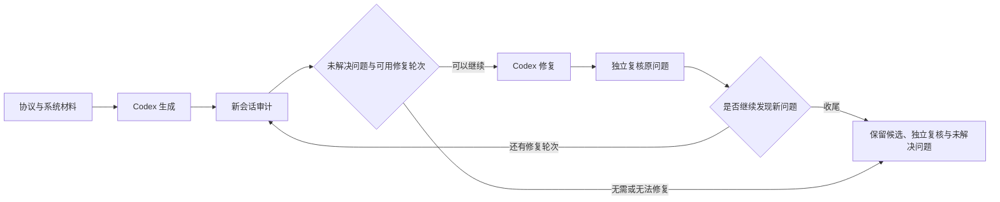

# Consensus Forge

本分支围绕混合同步 EPaxos 设计，组织“生成系统 → 审计 → 修复 → 独立复核”的实验；修复轮次允许时继续新的审计，最后审计仍可修复并以独立复核收尾。Python 负责材料、预算、版本和记录；实现与审计交给 Codex CLI。生成、修复、审计和复核模型均为 `gpt-6.1-sol`，推理强度为 `high`。

统一使用 `forge.py` 启动实验，配置位于 `configs/workflow.json`，运行产物统一写入 `experiments/`。实验目录按需创建；已有实验记录保留，新配置只用于新准备的实验。

## 当前生成目标

生成可运行的 Go KV 共识服务：可复用 Node、独立服务器进程、真实网络、多客户端并发、执行结果、后台真实计时、可控执行、测试与启动文档。客户端使用相同请求号和载荷跨入口重试；协议实例号与请求号分离，实例分别执行完成，应用效果与结果按请求去重。所有自动化测试代码放在 `tests/`，具体测试和实现组织由 agent 选择。

共同设计材料是 [protocol.md](inputs/protocol.md) 和 [system.md](inputs/system.md)，分别定义协议及内嵌伪代码、系统目标。当前英文材料由审阅后的中文稿同步，协议依据桌面的“剪枝2”设计，采用 W/s 广播窗口、Collect、PreAccept/Accept、ballot 恢复、HELP、Omega、依赖向量和 carry。范围为固定成员、crash-stop；执行后释放本地准入槽，仍保留后续扫描和恢复所需的历史，不包含旧版 epoch 或检查点流程。

K 限制每个副本已经准入但尚未在本地执行完成的实例数，不是历史容量上限。测试规模按具体问题选择，实际成本需随历史规模观察，不预设恒定内存或任意规模下的固定延迟。已执行的重复请求返回 ALREADY_EXECUTED，不要求永久保存原结果。

生成 agent 从简短的 DESIGN 草稿开始，解释重要实现选择、状态归属及完成事件，并沿实际代码检查。重点包括共享冲突登记与逐实例状态、窗口与回复阶段、证据取齐与失效任务、槽释放与客户端去重。具体同步、接收入口、调度和数据结构由 agent 决定。审计依据共同规则和实际行为判断，修复与独立复核不把偏好的机制当成标准答案；设计文档不替代协议或执行证据。

`runtime/schedule.py` 提供可选的事件调度与重放：通过薄适配器调用候选的实际接口，选择待处理动作，并在隔离执行日志中保留请求和实际观察。生成、审计、修复、复核都可使用；不要求候选采用固定接口，也不据此自动判定缺陷或修复。格式、证据交接和验证范围见 [docs/scheduling.md](docs/scheduling.md)。

## 开始使用

需要 Linux、Python 3.10+、Git、Go、Bubblewrap 和已登录的 Codex CLI。审计实现已从 CA 普通审计迁入本项目的 `auditor/`，运行不再依赖相邻的 `consensus-assurance` 源码或虚拟环境。控制器使用标准库；审计第三方依赖见 `requirements.txt`，由 `audit_python` 指定的本项目 `.venv` 提供。真实审计保留原有权限与命名空间隔离，需要终端允许创建命名空间。`doctor` 检查本地工具和审计模块导入，不读取认证文件、不调用模型，也不验证账号可用性或完整审计隔离环境。

```bash
cd /home/nitro/Desktop/consensus-forge-vft-epaxos
python3 -m venv .venv
.venv/bin/python -m pip install -r requirements.txt
.venv/bin/python forge.py doctor
.venv/bin/python -m unittest discover -s tests -v
```

只准备当次材料和配置，不调用模型：

```bash
.venv/bin/python forge.py prepare --label preview
```

启动完整实验，使用默认的双模型 `gpt-6.1-sol / high` 配置：

```bash
.venv/bin/python forge.py run --label sol-high-system-01
```

也可以执行前面 `prepare` 输出的目录，或查看已有运行：

```bash
.venv/bin/python forge.py execute /absolute/path/to/prepared/experiment
.venv/bin/python forge.py inspect /absolute/path/to/experiment
```

`run` / `execute` 会将所选材料与候选源码提供给模型，并允许 agent 在各自既有权限范围内运行程序。Ctrl-C 或 SIGTERM 会停止流程并保留已产生的证据；不要用 SIGKILL 代替正常中断。发现审计因服务端错误、安全拦截，或单回合超时且没有完整报告而停止后，控制器将已有问题及归档证据交给修复，明确标注报告未完成，再独立复核；没有可用问题时保留未完成状态。旧实验如果停在这个交接位置，可以执行 `.venv/bin/python forge.py resume <实验目录>`，从原候选和归档继续，不重新生成或重试被拦截的会话。若独立复核在开始调查前因 `workspace routing discovery failed` 连接失败，同一命令会保留失败记录，使用原来的前后候选和交接材料重新启动独立复核，再继续后续流程。此入口不恢复任意阶段；修订材料或调整配置仍应准备新实验。

## 默认流程和停止方式



配置在 [configs/workflow.json](configs/workflow.json)。生成和修复由 agent 根据交付情况自行结束，不设阶段或整场总时限；审计和独立复核分别计时，最多修复三轮。每次生成、修复、独立复核和新问题审计分别启动新会话。复核接收原始证据、修复声明和前后两个代码版本，检查原问题及修复可能破坏的原有行为，另外发现的有据缺陷也进入待处理列表；新审计只接收当前候选，自主寻找新问题。最后一次发现审计仍可进入修复，并以独立复核收尾，不再强制追加发现审计。未修好或复核新发现的问题保留为开放状态。

| 项目 | 默认上限 |
| --- | --- |
| 整个实验 | 统计实际耗时，不设总时限 |
| 初始生成 | agent 判断交付时机 |
| 每次发现审计（包括首次、后续及末次） | 60 分钟 |
| 每次修复 | agent 判断交付时机 |
| 每次修复后的独立复核 | 30 分钟，完成任务可提前结束 |
| 每次审计中的模型回合 | 最多 20 回合，每回合 15 分钟 |
| 每个隔离执行动作 | 5 分钟 |
| 修复次数 | 最多 3 次 |

审计和复核的预算是上限，不要求耗尽；生成和修复根据任务交付情况自行结束。每次发现审计使用统一的 `audit_seconds`，每次独立复核使用 `repair_verification_seconds`，交接耗时不挤占这些预算。提示词要求 agent 处理实际缺陷和未解释失败，在相关检查与文档就绪后交付，不因还可以想出更多场景而无限扩展调查；无法解决的问题应如实交接。最后一轮修复在独立复核后结束，其他轮次按问题状态和轮次限制继续。单次隔离命令仍有超时，Ctrl-C 与 SIGTERM 仍可中断实验；没有整场时间、token 或费用上限。`--max-repairs 0` 表示只生成并审计一次，同样使用 60 分钟的审计上限。旧的 `--total-seconds` 参数及生成、修复、整场时限配置已移除；baseline 默认也不设生成阶段时限，其独立入口仍可为特定实验显式指定上限。

停止原因分别记录在 `stop_reason`：没有未解决问题、末次复核完成（`final_review_complete`）、修复轮次上限、明确无改动、规格缺口、复核不完整、执行环境问题等。描述性字段支持文本、列表和对象；版本、ID、状态和证据路径仍严格检查。`issues.json.import_status` 与 `forge.py inspect` 的 `issue_index_status` 区分未导入和有效空结果。缺少 `findings.json` 不等于没有发现，修复 agent 自称已修复也不会关闭问题。旧问题只有独立复核给出相应结论后才变更状态；新审计没有提到旧问题不会消除它。复核失败或不完整时明确停止并保留未解决问题，不用另一轮发现审计替代未完成的复核。

规格缺口按问题处理：修复侧提出的 `needs_specification` 先交给独立复核。确认后该项仍计入未解决问题，并列入 `awaiting_specification`，但暂时不进入后续修复批次；其他问题继续推进。交接的 `repair_issue_ids` 明确本轮任务，已暂缓问题及其证据仍保留为上下文。只剩已确认缺口时才因此收尾，agent 擅自改写输入材料仍会停止交付。

`cycle_complete` 是流程结束状态。`issues.json` 中的 `fixed` 或 `not_substantiated` 表示独立复核 agent 对某项问题给出的结论，原始证据随结论保留。实验不设置 `assessment` 字段，也不模拟实验外的研究者裁定。流程完成或已报告问题关闭不意味着系统整体正确；研究结论由实验外的分析给出。

后续修复通过 `feedback/<轮次>/history.json` 获取已关闭问题和复核新增证据，按改动选择回归检查；历史关闭版本不会自动更新成最新版本。复核在预算内补齐报告、问题项及执行关联后结束，`fixed` 需引用本次复核的实际执行记录，但记录本身不证明断言正确。是否因无改动停止依据候选实际差异，保留与模型声明不一致的记录。调查过程及误判的人工分析方式见 [docs/evaluation.md](docs/evaluation.md)。

## 材料和代码入口

| 路径 | 作用 |
| --- | --- |
| `inputs/TASK.md` | 初始生成的增量构建、调查和交付任务 |
| `inputs/IMPLEMENTATION.md` | 生成与修复共用的工程方法、证据解释和工作边界 |
| `inputs/protocol.md` | 混合协议模型、规则及内嵌事件伪代码 |
| `inputs/system.md` | 服务、网络、客户端、并发、时间、可控执行及交付边界 |
| `inputs/AUDIT.md` | 初次审计及同会话续审的提示，仅供审计阶段使用 |
| `inputs/VERIFY.md` | 修复后的独立复核任务，检查原问题、前后版本及证据极性 |
| `inputs-zh/` | 与七份英文提示词对应的中文审阅稿，不参与实验输入；见 [阅读说明](inputs-zh/README.md) |
| `inputs/REPAIR.md` | 如何核查审计证据、修复、记录逐项处理结果，仅在修复阶段作为 prompt 使用 |
| `forge.py` / `workflow.py` | 完整实验入口与阶段调度 |
| `workflow_config.py` | 模型、路径、阶段预算与修复次数 |
| `audit_bridge.py` | 导出候选代码并调用本地审计入口 |
| `generator/` | 生成和修复共用的执行代码，与 `auditor/` 并列；`__init__.py` 为包声明 |
| `generator/runner.py` | 准备阶段工作区、调用原生 Codex、记录事件、处理超时和中断；生成和修复使用同一执行器 |
| `generator/execution.py` | 为生成/修复挂接公共隔离执行服务，启动前验证真实 STDIO 与私有 TCP |
| `generator/client.py` | 生成/修复的私有 Codex 配置、显式项目指令、认证副本和无模型上下文检查 |
| `generator/config.py` | 生成与修复阶段内部使用的执行参数，由工作流传入 |
| `auditor/` | 可独立修改的审计循环、Codex 会话、隔离执行与证据保留，模块说明见 [auditor/README.md](auditor/README.md) |
| `requirements.txt` | 本地审计运行所需的第三方 Python 依赖 |
| `issues.py` | 问题索引、轨迹检查注记、跨版本证据路径映射、修复导航与独立复核关联 |
| `runtime/agent_records.py` | 汇总当前阶段的原生主会话与子会话元数据、实际模型、回合时间及去重后的响应 token，缺失记录明确标为不完整 |
| `runtime/schedule.py` | 通过候选适配器进行有限事件调度与严格重放，stdout 保留实际请求和观察 |
| `runtime/` | 生成与审计共同依赖的执行、配置辅助、工具链、存储筛选、版本重放和证据关联；不依赖两个 agent 角色 |
| `runtime/replay.py` | 为隔离命令准备指定候选的私有副本，保留补充测试文件并清理临时副本 |
| `runtime/evidence.py` | 关联实际执行记录、检查安全证据路径，并生成针对具体缺口的反馈 |
| `artifacts.py` | 候选版本关联、最后完整审计回合还原与反馈传递 |
| `processes.py` | 工作流辅助子进程的超时、中断、清理与日志记录 |
| `tests/` | 控制器离线测试，不是候选共识测试 |

双方得到相同的 `protocol.md` 和 `system.md`，没有提供可运行协议参考实现、研究者测试答案或固定 Go 骨架。baseline 自主组织实现与自测；主流程在角色提示中额外提供工程方法，再安排独立审计、证据修复和复核。两个输入目录独立维护，协议与系统要求的修改应同步，通用方法指导不加入 baseline。比较必须使用同一协议与系统范围，历史实验按各自保存的输入分析，不改写旧材料和证据。中文材料来源与约定见 [inputs-zh/README.md](inputs-zh/README.md)，所有 Markdown 段落保持单行。

研究者待讨论的保证范围与证明义务记录在 [docs/design-issues.md](docs/design-issues.md)，不作为额外 agent 输入。已经明确的协议规则与可自由选择的工程机制分开说明。

论文主线、方法抽象、实验假设和讨论记录放在 [docs/paper.md](docs/paper.md)，具体实验数据仍保留在各次对比报告中。

新版实现侧指令统一命名为 `IMPLEMENTATION.md`，由执行器显式加载，仓库根部的 `AGENTS.md` 仍用于维护本项目。baseline 同步文件名但保留自身提示内容。旧实验使用相应 Git 版本复现，本版不自动迁移旧文件名或材料。

材料平铺在 `inputs/`：TASK 是生成任务，AUDIT 是审计任务，REPAIR 是修复任务，VERIFY 是独立复核任务，IMPLEMENTATION 是生成与修复共用的工作要求；protocol 包含协议正文与伪代码，system 是双方共用的系统目标与交付要求，通用工程指导在角色提示中。初始生成不收到审计、修复、复核任务；各阶段使用当次保存的输入。两份设计材料随候选交付审计，并随前后版本进入修复和复核。角色提示的 `<!-- continuation -->` 分隔首次与续轮任务。

## 结果在哪里

最近一次探索性评测见 [v000 与 v003 评测（2026-11-10）](docs/exploratory-1110.md)，包括并发性能、协议符合性、正确性和原始证据入口。该报告是实验后的研究分析，不作为 agent 输入。

每次完整实验位于 `experiments/<时间>-<标签>-<随机后缀>/`。各模型阶段另有 `agents.json` 和 `agent-records/`，保存主会话与子会话的归属、模型、回合时间和记录到的用量；`experiment.json` 的阶段条目提供对应路径与摘要。包含以下目录：

```text
experiment.json              阶段、预算、版本、停止原因和模型配置
inputs/                      当次材料副本，包含 AUDIT.md、REPAIR.md 和 VERIFY.md
stages/<...>/                生成或修复 workspace、prompt、事件、stderr、最终回答
candidates/v000/             第一个独立 Git 候选仓库
candidates/v001/             修复后的候选仓库
captures/v000/               导出进程日志和文件筛选结果
audits/000/                   本轮本地审计配置、原始运行和进程输出
handoffs/000/                最后完整审计状态、复现材料和原始记录
feedback/000/                待处理问题、已关闭历史及原始审计/复核证据
reviews/001/                 复核上下文、独立会话及其完整交接包
issues.json                  全部问题的来源版本、证据、状态与复核历史
```

候选版本直接使用 Git commit 关联，不引入额外内容哈希。实现、测试和说明文档按原字节交接，不按文件名或内容猜测凭据；测试密码、证书样例与配置示例可以正常保留。认证与框架私有运行文件位于候选工作区之外。导出继续排除私有运行目录、反馈目录、指令文件、符号链接、可执行二进制和临时输出，原因留在记录中。原始生成 workspace 始终保留。

修复接收的是报告和证据，不是控制器概括过的几句话。交接包明确提醒：某些复现测试的 `PASS` 表示“成功触发缺陷”，不能把所有绿色测试都当作系统正确。通常使用最后完整报告，其后未完成回合保留为补充材料；发现审计以 `external_error` 停止时，允许从最新归档重建交接，并显式保留中断状态和原因。所有问题都仍需修复侧核查和独立复核。新的候选不包含旧审计反馈目录，但会保留 agent 加入的回归测试。

`feedback/<轮次>/overview.md` 用短摘录和链接供修复 agent 导航；完整报告和原始字段仍在交接包内。可选案例与未决问题进入 `evidence-index.json`，供后续修复、复核选择复用，保留各自记录版本，不自动变成当前版本结论。`isolated_exec.outputs` 可在清理前归档指定输出文件/目录，保存位置和排除原因见执行结果的 `artifacts`。问题引用 `executions/<id>/result.json` 或该执行日志时，控制器关联命令、状态、起始源码、输入恢复路径与产物；原生 shell 则用 `turns/<回合>/stdout.jsonl#<item_id>` 精确选择命令。命令保持原样，旧绝对路径和临时二进制需 agent 检查或重建；控制器不自动执行这些命令。`evidence_feedback` 提供执行与版本关联的具体疑点，不能替代断言与性质的语义审阅。旧 `trace_files` 仍可保留导航，新导入的 `trace_checks` 为空，不产生协议时间结论。格式及边界见 [docs/workflow.md](docs/workflow.md)。

隔离执行可选 `source` 和 `overlays` 参数：审计的 `candidate` 指当前候选，复核另有 `before`，修复的 `candidate` 指修复前输入。工具复制对应源码并加入 agent 自选的测试文件，保留起始 commit、补充文件、命令和输出；默认仍使用可修改工作区。该记录证明起始输入和执行事实，不能证明任意命令真正检查了所述性质。审计续轮会收到新的具体证据问题，相同问题不反复推送；修复和复核也收到这些反馈及原始记录。使用示例见 [docs/workflow.md](docs/workflow.md)。

生成/修复使用临时私有 `HOME` 和 `CODEX_HOME`，不继承本机用户配置、自动指令、skills、记忆或插件。项目 `inputs/IMPLEMENTATION.md` 从本阶段保存的材料显式传入，自动发现的项目说明关闭；仅注册框架提供的执行工具，仍允许原生子智能体。启动前用本机 CLI 检查实际上下文，保留 `client-prompt.json` 与 `client-settings.json`；前者是无模型检查上下文，实际任务正文仍在 `prompt.txt`。生成侧仅复制现有文件式 ChatGPT 认证，或使用显式 `CODEX_API_KEY`；不读取用户配置中的 provider/profile，不自动登录，退出前采集会话用量并清理私有目录。整个工作流的审计侧仍要求其既有认证方式。

生成/修复普通 shell 仍使用 Codex `workspace-write`，这次隔离的是配置和自动加载内容，没有增加主机文件读取隔离。因此独立会话仍不构成严格隐藏评测环境。`forge_local.isolated_exec` 保留私有网络、PID 空间、干净环境、受限文件访问和执行记录；可运行 Go race 与多进程 TCP 测试，所有互通进程必须在同一次工具调用中启动。启动前做无模型的 STDIO/TCP 检查，失败则停止，不退回主机执行。本地审计保留原有隔离措施。

新流程准备好后可启动新实验，核查真实多进程测试和独立复核是否产生足够证据。评估边界与后续扩展见 [docs/evaluation.md](docs/evaluation.md) 和 [docs/workflow.md](docs/workflow.md)。

可选的本地真实隔离检查（无认证、无模型调用，需要 Linux 命名空间权限）：

```bash
.venv/bin/python tests/check_local_execution.py
```
