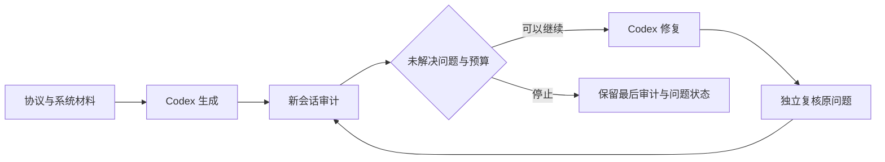

# Consensus Forge

围绕同步 per-command EPaxos 设计，组织“生成系统 → 审计 → 修复 → 独立复核 → 新审计”的实验。Python 负责材料、预算、版本和记录；实现与审计都交给 Codex CLI。生成及修复模型、审计模型均为 `gpt-6.1-sol`，推理强度均为 `high`。

统一使用 `forge.py` 启动实验，配置位于 `configs/workflow.json`，运行产物统一写入 `experiments/`。实验目录按需创建；已有实验记录保留，新配置只用于新准备的实验。

## 当前生成目标

生成可运行的 Go KV 共识服务：可复用的共识节点、独立服务器进程、真实网络传输、多个客户端的并发请求、正常路径的执行结果、后台真实计时、可控时间和消息调度、测试与启动文档。每个逻辑命令只提交一次，客户端超时或断连后报告结果未知，不重试、不换节点找回结果，也不恢复旧的未完成请求。副本仍须自主接管、恢复命令并保证每条命令在每个副本只执行一次。所有自动化测试代码放在 `tests/`，具体测试内容与实现组织仍由 agent 选择。

协议规则以 `inputs/protocol.md` 为准。当前暂定采用客户端单次提交的范围，聚焦共识推进和实现质量；保留 `(ClientID, RequestSeq)`、执行完成后回复、真实并发与多进程运行。正常路径完整收集所有存活成员的观察后，再选择 Fast 或 Seal；命令在本地执行完成并保留结果后，退出本地未来冲突观察，原有历史记录继续保留。该剪枝不需要执行报告消息，安全性推导见 [本地剪枝说明](docs/local-pruning-safety.md)。未新增 crash-restart、动态成员、快照、任意网络分区恢复或安全历史删除协议。系统可以在固定成员、crash-stop 与同步时间假设下运行；不能因此宣称已经达到 etcd 的生产能力。

生成 agent 从简短的 `DESIGN.md` 草稿开始，随实现更新关键状态归属、具体机制和完成事件，交付时对应到实际文件、函数及入口，并区分设计理由与已执行的检查。说明重点包括首次观察与登记、发送与计时、决定与执行、客户端等待与副本义务；具体代码结构、同步方式和测试仍由 agent 选择。审计沿设计定位代码，同时独立检查实际入口和机制是否符合协议；修复更新受影响的设计说明，独立复核检查原问题和原有行为。设计文档不替代协议要求或执行证据。

框架提供可选的 `runtime/tracecheck.py`，检查有限事件记录中的发送引用、完成后的交付期限和 crash-stop 一致性。控制器会读取报告引用的轨迹并保存检查结果，但不会执行 agent 提交的脚本，也不会把轨迹自洽判为共识正确。使用方法与边界见 [docs/workflow.md](docs/workflow.md)。

`runtime/schedule.py` 提供可选的事件调度与重放：通过薄适配器调用候选的实际接口，选择待处理动作，并在隔离执行日志中保留请求和实际观察。生成、审计、修复、复核都可使用；不要求候选采用固定接口，也不据此自动判定缺陷或修复。格式、证据交接和验证范围见 [docs/scheduling.md](docs/scheduling.md)。

## 开始使用

需要 Linux、Python 3.10+、Git、Go、Bubblewrap 和已登录的 Codex CLI。审计实现已从 CA 普通审计迁入本项目的 `auditor/`，运行不再依赖相邻的 `consensus-assurance` 源码或虚拟环境。控制器使用标准库；审计第三方依赖见 `requirements.txt`，由 `audit_python` 指定的本项目 `.venv` 提供。真实审计保留原有权限与命名空间隔离，需要终端允许创建命名空间。`doctor` 检查本地工具和审计模块导入，不读取认证文件、不调用模型，也不验证账号可用性或完整审计隔离环境。

```bash
cd /home/nitro/Desktop/consensus-forge
python3 -m venv .venv
.venv/bin/python -m pip install -r requirements.txt
.venv/bin/python forge.py doctor
.venv/bin/python -m unittest discover -s tests -v
```

只准备当次材料和配置，不调用模型：

```bash
.venv/bin/python forge.py prepare --label preview
```

启动完整实验，使用默认的双模型 `gpt-6.1-sol / high` 配置：

```bash
.venv/bin/python forge.py run --label sol-high-system-01
```

也可以执行前面 `prepare` 输出的目录，或查看已有运行：

```bash
.venv/bin/python forge.py execute /absolute/path/to/prepared/experiment
.venv/bin/python forge.py inspect /absolute/path/to/experiment
```

`run` / `execute` 会将所选材料与候选源码提供给模型，并允许 agent 在各自既有权限范围内运行程序。Ctrl-C 或 SIGTERM 会停止流程并保留已产生的证据；不要用 SIGKILL 代替正常中断。当前不支持断点续跑，已经开始的目录不能重新执行。修订材料或调整配置后准备新实验，旧目录保留供对照。

## 默认流程和停止方式



配置在 [configs/workflow.json](configs/workflow.json)。默认总预算 240 分钟，最多修复三轮。每次生成、修复、独立复核和新问题审计分别启动新会话。复核接收原始证据、修复声明和前后两个代码版本，检查原问题及修复可能破坏的原有行为，另外发现的有据缺陷也进入待处理列表；新审计只接收当前候选，自主寻找新问题。审计会话根据剩余时间安排最后一次收尾。

| 项目 | 默认上限 |
| --- | --- |
| 整个实验 | 240 分钟 |
| 初始生成 | 90 分钟 |
| 首次独立审计 | 60 分钟 |
| 修复后的新问题审计 | 30 分钟 |
| 每次修复 | 30 分钟 |
| 每次修复后的独立复核 | 15 分钟，完成任务可提前结束 |
| 保留给最后一次新问题审计 | 30 分钟 |
| 启动下一轮修复所需的最低可分配时间 | 5 分钟，另需留足复核与末次审计时间 |
| 每次审计中的模型回合 | 最多 20 回合，每回合 15 分钟 |
| 每个隔离执行动作 | 5 分钟 |
| 修复次数 | 最多 3 次 |

这些是阶段上限，不是必须耗尽的固定分段，全部受总墙钟约束。生成或修复提前完成时，剩余时间留给后续轮次。启动生成或修复前保留末次审计时间；修复还要留出独立复核和交接余量。无法容纳下一轮修复时进行最后审计后停止，而不是启动一个注定被总预算截断的修复。清理与证据归档可能多用数秒；没有 token 或费用上限。`--max-repairs 0` 表示只生成并审计一次，这次审计仍使用首次审计的 60 分钟上限，实际分配受剩余总预算限制。

停止原因分别记录在 `stop_reason`：没有未解决问题、修复轮次上限、剩余修复预算不足、明确无改动、规格缺口、复核不完整、执行环境问题等。描述性字段支持文本、列表和对象；版本、ID、状态和证据路径仍严格检查。`issues.json.import_status` 与 `forge.py inspect` 的 `issue_index_status` 区分未导入和有效空结果。缺少 `findings.json` 不等于没有发现，修复 agent 自称已修复也不会关闭问题。旧问题只有独立复核给出相应结论后才变更状态；新审计没有提到旧问题不会消除它。复核不完整时仍保留未解决问题并使用预留时间做最后一次新审计。

规格缺口按问题处理：修复侧提出的 `needs_specification` 先交给独立复核。确认后该项仍计入未解决问题，并列入 `awaiting_specification`，但暂时不进入后续修复批次；其他问题继续推进。交接的 `repair_issue_ids` 明确本轮任务，已暂缓问题及其证据仍保留为上下文。只剩已确认缺口时才因此收尾，agent 擅自改写输入材料仍会停止交付。

`cycle_complete` 是流程结束状态。`issues.json` 中的 `fixed` 或 `not_substantiated` 表示独立复核 agent 对某项问题给出的结论，原始证据随结论保留。实验不设置 `assessment` 字段，也不模拟实验外的研究者裁定。流程完成或已报告问题关闭不意味着系统整体正确；研究结论由实验外的分析给出。

后续修复通过 `feedback/<轮次>/history.json` 获取已关闭问题和复核新增证据，按改动选择回归检查；历史关闭版本不会自动更新成最新版本。复核在预算内补齐报告、问题项及执行关联后结束，`fixed` 需引用本次复核的实际执行记录，但记录本身不证明断言正确。是否因无改动停止依据候选实际差异，保留与模型声明不一致的记录。调查过程及误判的人工分析方式见 [docs/evaluation.md](docs/evaluation.md)。

## 材料和代码入口

| 路径 | 作用 |
| --- | --- |
| `inputs/TASK.md` | 从库升级为完整可运行系统的任务书 |
| `inputs/AGENTS.md` | 候选 workspace 的工作范围、测试目录和执行要求 |
| `inputs/protocol.md` | 同步协议的规则、已有论证及客户端提交范围 |
| `inputs/system.md` | 服务、网络、客户端、并发、时间、可控执行及交付边界 |
| `inputs/AUDIT.md` | 初次审计及同会话续审的提示，仅供审计阶段使用 |
| `inputs/VERIFY.md` | 修复后的独立复核任务，检查原问题、前后版本及证据极性 |
| `inputs/REPAIR.md` | 如何核查审计证据、修复、记录逐项处理结果，仅在修复阶段作为 prompt 使用 |
| `forge.py` / `workflow.py` | 完整实验入口与阶段调度 |
| `workflow_config.py` | 模型、路径、阶段预算与修复次数 |
| `audit_bridge.py` | 导出候选代码并调用本地审计入口 |
| `generator/` | 生成和修复共用的执行代码，与 `auditor/` 并列；`__init__.py` 为包声明 |
| `generator/runner.py` | 准备阶段工作区、调用原生 Codex、记录事件、处理超时和中断；生成和修复使用同一执行器 |
| `generator/execution.py` | 为生成/修复挂接公共隔离执行服务，启动前验证真实 STDIO 与私有 TCP |
| `generator/client.py` | 生成/修复的私有 Codex 配置、显式项目指令、认证副本和无模型上下文检查 |
| `generator/config.py` | 生成与修复阶段内部使用的执行参数，由工作流传入 |
| `auditor/` | 可独立修改的审计循环、Codex 会话、隔离执行与证据保留，模块说明见 [auditor/README.md](auditor/README.md) |
| `requirements.txt` | 本地审计运行所需的第三方 Python 依赖 |
| `issues.py` | 问题索引、轨迹检查注记、跨版本证据路径映射、修复导航与独立复核关联 |
| `runtime/agent_records.py` | 汇总当前阶段的原生主会话与子会话元数据、实际模型、回合时间及去重后的响应 token，缺失记录明确标为不完整 |
| `runtime/tracecheck.py` | 标准库有限事件记录检查器，可独立运行；不实现共识规则或正确性裁判 |
| `runtime/schedule.py` | 通过候选适配器进行有限事件调度与严格重放，stdout 保留实际请求和观察 |
| `runtime/` | 生成与审计共同依赖的执行、配置辅助、工具链、存储筛选、版本重放和证据关联；不依赖两个 agent 角色 |
| `runtime/replay.py` | 为隔离命令准备指定候选的私有副本，保留补充测试文件并清理临时副本 |
| `runtime/evidence.py` | 关联实际执行记录、检查安全证据路径，并生成针对具体缺口的反馈 |
| `artifacts.py` | 候选版本关联、最后完整审计回合还原与反馈传递 |
| `processes.py` | 工作流辅助子进程的超时、中断、清理与日志记录 |
| `tests/` | 控制器离线测试，不是候选共识测试 |

没有提供协议参考实现、研究者测试答案或固定的 Go 包骨架。工程职责和交付边界有所明确，agent 仍负责选择具体设计和测试。材料整理与工程要求都是实验输入的一部分，详见 [docs/material-preparation.md](docs/material-preparation.md)。所有 Markdown 段落保持单行。

协议与系统设计的已补规则、开放问题及当前范围限制集中记录在 [docs/design-issues.md](docs/design-issues.md)，供研究者后续讨论；该文档不作为 agent 输入，也不改变当前协议要求。

现有 baseline 与主流程初始、最终候选的共同场景比较放在 [comparison/](comparison/README.md)，包含真实 Node 测试、TCP/HTTP 交叉检查和历史增长测量。[首轮结果](comparison/report-2026-11-04.md)与原始候选分开保存，不作为生成或审计输入。

提示与参考材料平铺在 `inputs/`：`TASK.md` 是生成提示，`AUDIT.md` 是审计提示，`REPAIR.md` 是修复提示，`VERIFY.md` 是独立复核提示，`AGENTS.md` 是工作要求，`protocol.md` 和 `system.md` 是协议与工程参考材料。控制器按阶段选择输入，初始生成不会收到 `AUDIT.md`、`REPAIR.md` 或 `VERIFY.md`。每次实验会复制当次使用的材料，后续审计读取实验内的 `inputs/AUDIT.md` 副本。审计提示用一个 `<!-- continuation -->` 分隔首次任务和续审提示。

## 结果在哪里

每次完整实验位于 `experiments/<时间>-<标签>-<随机后缀>/`。各模型阶段另有 `agents.json` 和 `agent-records/`，保存主会话与子会话的归属、模型、回合时间和记录到的用量；`experiment.json` 的阶段条目提供对应路径与摘要。包含以下目录：

```text
experiment.json              阶段、预算、版本、停止原因和模型配置
inputs/                      当次材料副本，包含 AUDIT.md、REPAIR.md 和 VERIFY.md
stages/<...>/                生成或修复 workspace、prompt、事件、stderr、最终回答
candidates/v000/             第一个独立 Git 候选仓库
candidates/v001/             修复后的候选仓库
captures/v000/               导出进程日志和文件筛选结果
audits/000/                   本轮本地审计配置、原始运行和进程输出
handoffs/000/                最后完整审计状态、复现材料和原始记录
feedback/000/                待处理问题、已关闭历史及原始审计/复核证据
reviews/001/                 复核上下文、独立会话及其完整交接包
issues.json                  全部问题的来源版本、证据、状态与复核历史
```

候选版本直接使用 Git commit 关联，不引入额外内容哈希。导出会沿用 CA 的凭据筛选，排除反馈目录、指令文件、符号链接、可执行二进制和临时输出，排除原因留在记录中。原始生成 workspace 始终保留。

修复接收的是报告和证据，不是控制器概括过的几句话。交接包明确提醒：某些复现测试的 `PASS` 表示“成功触发缺陷”，不能把所有绿色测试都当作系统正确。后续未完成回合只保留为原始记录，不覆盖最后完整报告。新的候选不包含旧审计反馈目录，但会保留 agent 加入的回归测试。

`feedback/<轮次>/overview.md` 用短摘录和链接供修复 agent 导航；完整报告和原始字段仍在交接包内。可选案例与未决问题进入 `evidence-index.json`，供后续修复、复核选择复用，保留各自记录版本，不自动变成当前版本结论。`isolated_exec.outputs` 可在清理前归档指定输出文件/目录，保存位置和排除原因见执行结果的 `artifacts`。问题引用 `executions/<id>/result.json` 或该执行日志时，控制器关联命令、状态、起始源码、输入恢复路径与产物；原生 shell 则用 `turns/<回合>/stdout.jsonl#<item_id>` 精确选择命令。命令保持原样，旧绝对路径和临时二进制需 agent 检查或重建；控制器不自动执行这些命令。`trace_checks` 与 `evidence_feedback` 提供记录层面的检查和具体疑点，不能替代断言与性质的语义审阅。格式及边界见 [docs/workflow.md](docs/workflow.md)。

隔离执行可选 `source` 和 `overlays` 参数：审计的 `candidate` 指当前候选，复核另有 `before`，修复的 `candidate` 指修复前输入。工具复制对应源码并加入 agent 自选的测试文件，保留起始 commit、补充文件、命令和输出；默认仍使用可修改工作区。该记录证明起始输入和执行事实，不能证明任意命令真正检查了所述性质。审计续轮会收到新的具体证据问题，相同问题不反复推送；修复和复核也收到这些反馈及原始记录。使用示例见 [docs/workflow.md](docs/workflow.md)。

生成/修复使用临时私有 `HOME` 和 `CODEX_HOME`，不继承本机用户配置、自动指令、skills、记忆或插件。项目 `inputs/AGENTS.md` 从本阶段保存的材料显式传入，自动发现的项目说明关闭；仅注册框架提供的执行工具，仍允许原生子智能体。启动前用本机 CLI 检查实际上下文，保留 `client-prompt.json` 与 `client-settings.json`；前者是无模型检查上下文，实际任务正文仍在 `prompt.txt`。生成侧仅复制现有文件式 ChatGPT 认证，或使用显式 `CODEX_API_KEY`；不读取用户配置中的 provider/profile，不自动登录，退出前采集会话用量并清理私有目录。整个工作流的审计侧仍要求其既有认证方式。

生成/修复普通 shell 仍使用 Codex `workspace-write`，这次隔离的是配置和自动加载内容，没有增加主机文件读取隔离。因此独立会话仍不构成严格隐藏评测环境。`forge_local.isolated_exec` 保留私有网络、PID 空间、干净环境、受限文件访问和执行记录；可运行 Go race 与多进程 TCP 测试，所有互通进程必须在同一次工具调用中启动。启动前做无模型的 STDIO/TCP 检查，失败则停止，不退回主机执行。本地审计保留原有隔离措施。

新流程准备好后可启动新实验，核查真实多进程测试和独立复核是否产生足够证据。评估边界与后续扩展见 [docs/evaluation.md](docs/evaluation.md) 和 [docs/workflow.md](docs/workflow.md)。

可选的本地真实隔离检查（无认证、无模型调用，需要 Linux 命名空间权限）：

```bash
.venv/bin/python tests/check_local_execution.py
```
