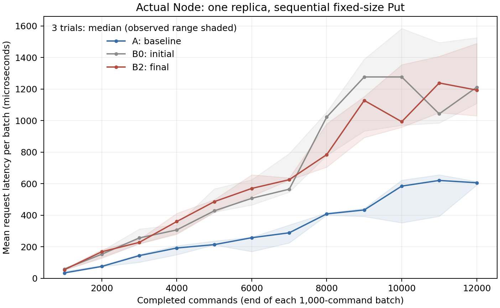

# baseline 与主流程实现的首轮共同测试

本轮的结论是：三个版本在所测的并发、真实依赖环和连续崩溃恢复场景上表现相同；工程边界各有强弱，主流程的审计—修复确实消除了自身的成员编码缺陷并捕获了一次修复回归。两份实现都接受有歧义的 JSON 字段输入，也都存在历史增长带来的处理成本上升。单 Node 测量中 baseline 更快，真实三进程短负载中主流程更快，应分别解释这两项结果。

原仓库代码已先推送到 GitHub，提交为 `2f4b0af`。此后新增比较材料，未修改任何原始候选、历史实验记录或模型提示，也未启动新的模型实验。比较的三个主体是 baseline、主流程初始交付 v000、最终交付 v002；v001 只用于重现修复回归。版本路径和运行命令见 [README](README.md)，逐项数据见 [results-2026-11-04.json](results-2026-11-04.json)。

## 共同的共识场景

| 场景 | baseline | v000 | v002 |
| --- | --- | --- | --- |
| 并发 Put/Get/Delete，三个协调者，协议消息重复投递 | 通过 | 通过 | 通过 |
| 通过实际 OBSERVE 形成双向依赖，阻塞应用回调，再检查 SCC 顺序和局部剪枝 | 通过 | 通过 | 通过 |
| 五副本中 b 已崩溃，a 部分广播后崩溃，c 接管并向原先不知情的 e 传播 | 通过 | 通过 | 通过 |

并发场景用了 20 个工作负载种子，每个包含 18 条操作，整组重复三轮；另外两个场景各重复三次。三份实现都使用同一份场景和断言代码，适配器只转换公开接口。检查运行在真实 Node 的 goroutine、队列、计时处理和实际 KV 回调上，没有直接调用 Core 或手工构造决定。全部检查开启 Go race detector，未报告数据竞争。

实际检查包括每副本执行次数、同一命令的应用结果、客户端返回值与应用结果的对应、已发送 DECIDE 的依赖集合是否冲突，以及没有注入相应崩溃时是否出现死亡事实。依赖环场景还检查真实决定确实建立了 x↔y，a 的实际执行顺序为 x、y、z、w，且 x 本地完成、y 尚未完成时，新命令 w 的观察只包含 y。恢复场景确认 c 在取得资格后重新读取原先不知情的 e，并发送第二代 Seal；c/d/e 都实际执行一次，客户端没有重提。

这里验证的是指定有限执行中的行为。没有声称检查任意调度下的线性一致性，也没有把不同实现选择不同合法顺序判成错误。受控时钟和传输替换了真实网络；每次向存活节点交付时检查消息没有超过配置的 Delta，发送完成后的消息不因发送者崩溃而取消。实际生产网络另用下面的检查覆盖。

原始执行：[共同场景三轮结果](runs/20261104T052539Z-correctness-mpazo8yj/results.json)。各候选副本的 `tests/comparison-traces/` 保存已发送消息和实际事件，`go-test.jsonl` 保存断言执行结果。

## 交叉边界检查与修复效果

| 检查 | baseline | v000 | v001 | v002 |
| --- | --- | --- | --- | --- |
| 普通成员 ID，真实三节点 TCP 执行 | 通过 | 通过 | 通过 | 通过 |
| 成员 ID 含换行 | 通过 | 请求未完成 | 通过 | 通过 |
| 成员 ID 含尾随空格 | 通过 | 请求未完成 | 通过 | 通过 |
| 800 KiB 成员 ID | 通过 | 通过 | 请求未完成 | 通过 |
| Delta = 2^62 ns | 接纳并错误证死真实存活节点 | 配置拒绝 | 配置拒绝 | 配置拒绝 |

成员检查使用各自的生产传输和三个真实 Node。成功必须包含应用实际执行、三个副本结果一致且各执行一次。8 秒是本次完成检查的观察窗口，不能单独当作协议承诺的时间界；这里对应的确定根因由原审计证据和源码支持：v000 将任意成员名称直接写入 HTTP 头，换行和空格无法按原身份传输；v001 改用 base64 后，大名称扩展超过 HTTP 头大小限制；v002 改用成员索引作为头部引用。三个版本的共识源文件相同，发生变化的生产文件只有 `nettransport/http.go`。

这完整重现了主流程的一次具体收益：修复解决原问题后引入回归，独立复核发现回归，下一次修复才同时通过原场景和新增场景。baseline 原本使用另一种传输编码，因此没有这项缺陷。不能把它统计成主流程最终版本相对 baseline 的优势。

Delta 检查没有规定所有实现都必须拒绝大数：若实现接受配置，就启动三个真实存活 Node，将消息保留后以约 10ms 的间隔交付。baseline 的计时计算溢出，实际产生了多个错误死亡事实；主流程在创建 Node 时拒绝了无法表示的配置。这个值约为 146 年，是配置边界缺陷，不是常用毫秒级 Delta 的故障证据。

原始执行：[四版本边界结果](runs/20261104T052903Z-boundary-b5jvrm_e/results.json)。这批失败测试以“正确行为应成立”为断言，FAIL 表示观察到问题；它们与原审计中“复现出错误则 PASS”的用例极性不同。

## HTTP 输入交叉检查

| 实际请求 | baseline | v000 | v002 |
| --- | --- | --- | --- |
| 正常请求 | 执行成功，后续读到写入值 | 同左 | 同左 |
| 同一对象中普通序号字段重复、值不同 | HTTP 400 拒绝，后续读不到值 | 使用后一序号执行，后续读到值 | 同 v000 |
| 序号字段重复，其中一项包含 Unicode 长 s `ſ` | 接纳并执行，后续读到值 | 接纳并执行，后续读到值 | 接纳并执行，后续读到值 |

该检查运行候选原有的服务器可执行程序，通过真实回环 HTTP 提交，未复制或重写服务端解码逻辑。每次写入后再提交新的 Get，确认接受输入确实改变了 KV，而不只是返回了 HTTP 200。baseline 的序号字段名是 `request_seq`，主流程是 `seq`，适配时保留各自 API，仅迁移“多个字段映射到同一身份字段”的触发方式。

baseline 的重复字段预检查使用 `strings.ToLower`，后续 Go 解码器的字段匹配范围更广，因此 Unicode 别名绕过了检查。主流程的 `DecodeJSON` 没有重复字段检查，所以普通重复字段也会被接受；这个行为在 v000 和 v002 都存在。以上接受行为已经实测；它们属于编码接纳边界，自带正常客户端不会生成这种请求，不应记作正常客户端流量下已经发生了共识不一致。对于主流程，规格只泛称拒绝 malformed 输入，没有逐项定义 JSON 重复成员的语义；是否作为明确违约缺陷，应与观察事实分开记录。baseline 源码则明确宣称拒绝重复对象字段，Unicode 用例直接暴露了其检查与解码之间的不一致。

原始请求、回复和后续读取见 [HTTP 检查结果](runs/20261104T052645Z-http-tbtjz5w9/results.json)。这个交叉检查说明，某项输入问题在一份实现的审计里被发现后，能成为另一份实现的有效检查材料；问题没有被主流程的成员编码修复覆盖。

## 历史增长与真实服务成本

单 Node 测量顺序执行 12,000 次固定大小的 Put，每 1,000 次为一个批次。三轮轮换候选顺序，不启用 race detector、观察回调或快照查询；下面是三个批次均值的中位数，不是把所有请求混合后计算的中位延迟。

| 版本 | 第 1–1,000 条平均延迟 | 第 11,001–12,000 条平均延迟 | 后者 / 前者 |
| --- | --- | --- | --- |
| baseline | 34.86 µs | 606.30 µs | 17.39 倍 |
| v000 | 59.32 µs | 1,211.56 µs | 20.43 倍 |
| v002 | 54.88 µs | 1,193.20 µs | 21.74 倍 |

这组数据表明，两份实现的本地冲突索引剪枝都没有消除历史增长对热路径的影响。源码中，baseline 的 `scheduleExecution` 遍历保留记录；主流程的 `readyBatch` 和 `nextDeadline` 也遍历历史。v000、v002 在这些代码上相同，其测量范围重叠，不能把小幅差异解释为修复改善了调度性能。这里没有做 CPU profile，因此历史扫描是源码支持的成本解释，没有定量归因每个函数占了多少时间。应用外层共同的结果记录也占用内存，不把测试进程内存全算给候选。

真实服务测量启动三个副本进程，baseline 另外启动 relay。使用真实 HTTP 客户端请求、真实时间和各自生产传输，配置 Delta=250ms，固定原协调者，一个在途请求，每次成功后等待 5ms，共 1,000 次 Put，最后分别经三个节点提交新的 Get。三轮测量中，每一轮的所有写回复和三个最终读检查都完成。下面是三轮运行均值的中位数，RSS 是最后一批次所有服务进程 RSS 之和的中位数。

| 版本 | HTTP 请求平均延迟 | 服务进程数 | 汇总 RSS |
| --- | --- | --- | --- |
| baseline | 6.366 ms | 3 副本 + 1 relay | 53.34 MiB |
| v000 | 4.368 ms | 3 副本 | 44.52 MiB |
| v002 | 4.325 ms | 3 副本 | 44.70 MiB |

短网络负载下，主流程的端到端延迟较低；这与单 Node 长历史测量的排序不同，说明需要区分内部处理成本与整个服务路径的成本。这不是峰值吞吐测试，RSS 也不是去重后的物理内存占用。baseline 的 relay 持续存活是其传输前提，主流程使用 f+1 副本托管消息；资源和部署选择不同，不把短负载延迟差异归因于某个提示词或某次修复。

原始执行：[单 Node 三轮结果](runs/20261104T052717Z-history-xogv6e3h/results.json)、[真实三进程三轮结果](runs/20261104T053253Z-network-6_invfl1/results.json)。每次测量均从新的空状态启动。运行环境与逐批数据保存在汇总 JSON 中；本轮未固定 CPU 核心，也未进行跨机器实验。

## 生成和流程投入

| 产物 | 墙钟时间 | 未命中缓存的输入 token | 输出 token |
| --- | --- | --- | --- |
| baseline 初始交付 | 20 分 12 秒 | 153,973 | 76,394 |
| v000 初始交付 | 39 分 58 秒 | 220,258 | 111,617 |
| v002 完整生成—审计—修复流程 | 127 分 4 秒 | 1,619,977 | 311,112 |

用量取自各阶段主/子会话去重后的 `agents.json`，完整主流程包括一次生成、三次新审计、两次修复、两次独立复核。没有重复累加 handoff 内的用量副本；reasoning token 是输出的子集，没有再次相加。缓存输入仍有成本，完整缓存用量保留在汇总 JSON，表中数字不是账单估算。baseline 生成后的独立审计和本次研究比较属于评估投入，未算进 baseline 原始交付的构造成本。

本轮适合报告的价值是具体机制和具体结果：初始交付都能通过这批共识场景；独立复核捕获了一个真实修复回归；跨实现迁移证据暴露了双方共有或不同的输入处理问题；长期成本问题在两个实现里都保留着。生成侧提示组织是否稳定提高整体质量，还需要用重复生成与可比资源实验回答，不能由这三份代码的优劣直接归因。

## 测试开发中排除的错误判断

第一版共同测试错误地假定“本地应用开始时，所有异步 DECIDE 发送已经记录”，导致三个版本的依赖环检查同时失败；保留的轨迹实际包含完整的 x↔y 决定。测试随后改为等待实际发送事件，再检查边。这是测试观察时机错误，不是候选没有形成依赖环。

第一版恢复检查还要求 READ_STATE 携带第二代 generation。两份实现都没有在这个消息字段中编码接管代数，因此该断言过度限制了表示方式。现在用 c 的实际前驱死亡事件确定资格时点，检查此后向原先不知情的 e 发出的 READ_STATE，并单独检查 SEAL 的 generation=2。对照轨迹确认原来的三个候选都已经完成恢复。原始失败材料保留在 [初版测试执行](runs/20261104T052339Z-correctness-ildemtim/results.json)，未计入候选缺陷。

最早的 Delta 比较只检查“大值被接受”，这个判定也过强：实现可以分段等待而安全支持大值。正式结果改为允许拒绝或安全运行，只有实际错误证死才失败。早期执行保留在 [初版边界检查](runs/20261104T052557Z-boundary-bscvvmug/results.json)。这些修订也说明，比较代码本身需要审阅，机械执行不会自动保证测试主张正确。
