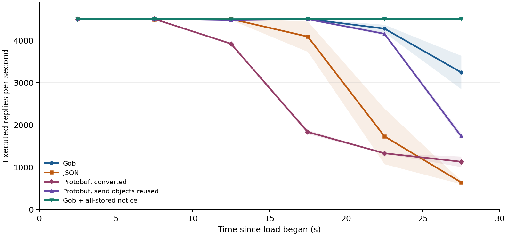

# 11 月 18 日第三次 baseline：副本编码选择与持续吞吐

本次 `sol62-high-baseline-1118-03` 使用 `gpt-6.2-sol/high`，单会话耗时 41 分 25 秒，正常交付。与当天上一轮 02 相比，模型、推理强度及四份提示词相同。本轮实际运行环境已经挂载离线工具和 Go 模块源。客户端继续使用 HTTP/JSON，副本通信选择了标准库的二进制 Gob。交付的 go.mod 没有第三方依赖，已保留的命令和说明中未见 Gob、JSON 与 Protobuf 的编码对照。两次独立生成可以用来观察选择的差异，但无法确定这次选择是由新增环境造成的。

## 网络与 agent 的自测

七个副本使用持久 TCP 连接和 TLS 1.3 双向证书指纹校验。每个目标副本有独立 writer，读取普通和数据两类队列，复用该连接的 Gob 编码器。writer 取到第一条消息后，至多再取 31 条已经就绪的消息，编码为一组并立即 flush，没有等待凑满的定时器。一个实例仍处理一条客户端请求。上一版使用持久 TLS/TCP 上的逐条 JSON 帧，后台库存通告可包含多个条目。传播策略也有差别：上一版通告库存后按需 Fetch，这版按各副本的存储回执补发缺失的初始值或决定。[本轮传输源码](../baseline/experiments/20261118T025720Z-sol62-high-baseline-1118-03-wx6ztkeu/workspace/transport/tcp.go) · [数据传播](../baseline/experiments/20261118T025720Z-sol62-high-baseline-1118-03-wx6ztkeu/workspace/consensus/data.go)

生成过程有实际自我修正。早期受控测试出现失败后，agent 增加 Collect 完成事件来校准测试时序。随后它修改了过载时对重复请求的处理，使入口能区分已执行、已接纳和新请求，并增加相应测试。七进程冒烟测试中，四个副本 crash-stop 后，三个幸存副本选出 Omega 4，新的 Delete 和 Get 取得符合预期的结果。我在最终源码副本上另跑了普通 Go 测试和 race 测试，均通过。

agent 自测采用 24 个闭环客户端向同一入口提交混合操作，每组约 10 秒。三 worker 时，合帧上限 32 和 1 分别约为 3,361 和 3,247 条/秒。三 worker、上限 32 时采样到的平均未决定实例数为 1.85，峰值 13。另一次 trace 观察到同一副本在不同 Go P 上处理不同实例的 PreAccept，有 131 段同时运行区间，合计约 0.545 ms。这支持“实现了副本内同阶段并行”；扩核或增加 worker 带来的吞吐收益仍取决于负载。[候选自测记录](../baseline/experiments/20261118T025720Z-sol62-high-baseline-1118-03-wx6ztkeu/workspace/VALIDATION.md)

## 两版固定速率复测

复用 02 的 Go 负载器，适配 03 的 HTTP 路径、会话编号格式和 Put 回复语义。七个独立副本与负载器各绑定一个 vCPU，每副本 GOMAXPROCS=1、worker=4。n=7、f=4、s=1、e=1、W=200 ms、tick=5 ms。每次重启集群，在私有回环网络中向随机入口发送独立键、16 字节值的 Put，固定速率持续 30 秒，每档两次，无故障或重试。客户端等待 15 秒。两版的队列及在途限制含义不同，02 的 512 限制作用于 HTTP handler，03 的 512 限制作用于 Node 等待者。03 终态统计可核对各入口的本地接纳与执行数，不能单凭该指标推断所有远端副本已执行。

| 输入（条/秒） | 02 窗口吞吐（条/秒） | 03 窗口吞吐（条/秒） | 03 最后 5 秒吞吐（条/秒） | 03 最终执行回复 / 实际发出，两次合计 |
|---:|---:|---:|---:|---:|
| 2,500 | 2,499.8～2,499.9 | 2,499.5～2,499.9 | 2,497～2,504 | 150,000 / 150,000 |
| 3,000 | 2,800.5～2,999.6 | 2,999.9～3,000.0 | 2,999.8～3,000.0 | 180,000 / 180,000 |
| 4,500 | 2,170.8～2,263.2 | 4,300.2～4,355.5 | 3,302～3,755 | 266,218 / 269,994 |

窗口吞吐按发送期间收到且符合该版本 Put 返回语义的 APPLIED 计算。03 在 3,000 档的两次全量平均延迟分别为 1.66 和 1.72 ms，P99 为 16.54 和 14.95 ms。4,500 档最后 5 秒已经落后于输入，客户端最终得到的回复为 266,218 次执行成功和 3,776 次接纳前拒绝（waiter limit），另有 6 条计划请求未发出。该档 02 执行回复为 137,843/270,000，同时出现大量拒绝和客户端超时。[02 测量](baseline-throughput-1118.md) · [03 逐次统计](/home/nitro/Desktop/baseline-throughput-1118-03/summary.csv)

同为 3,000 档，03 的两次 Fetch 计数均为 0，发送量约 60 条逻辑消息、11.2 kB/已接纳请求。02 的两次 Fetch 分别为约 3.6 万和 20.8 万，发送量约 24.3 和 41.5 kB/已接纳请求。03 字节计数在出站 TCP 写入处，包含 TLS 开销；02 统计交给 TLS 的应用层帧字节。两者不能直接计算编码压缩率。这些运行同时改变了消息内容、传播与调度机制，下文在同一份 03 实现上单独更换副本编码。

只改变 03 的合帧上限，在 4,500 档按相同两个种子复测。每帧最多 1 条消息时，两次窗口吞吐为 3,754.6 和 3,630.2 条/秒；恢复为最多 32 条时，对应为 4,355.5 和 4,300.2 条/秒，分别提高 16.0% 和 18.5%。单条帧的两次运行合计拒绝 41,253 条，另有 5 次客户端连接错误；上限 32 时拒绝 3,776 条，连接错误为零。两组编码均为 Gob，这一对照给出了高负载下合帧的实际贡献。

## 一项协议符合性发现

协议 §5.2 要求 HELP 回复标识发起验证的实例 x、被协助实例 y，以及 x 的恢复 ballot 和任务。03 处理 HELP 时，若 y 已经决定，会直接用通用的 decisionMessage(y, Done) 回复，它只填写 y、键、初始值和决定值。若先保留 HELP、等 y 决定后再回复，answerHelp 则额外填入 Other、Ballot 和 Attempt。两个分支对同一条关联要求处理不一致。接收方仍可用 Done 学习 y 的决定，目前证据支持消息字段的协议偏离，尚未观察到决定分歧或永久停滞。这一结论来自源码检查。[规则 §5.2](../baseline/experiments/20261118T025720Z-sol62-high-baseline-1118-03-wx6ztkeu/inputs/protocol.md#52-helping-a-conflicting-instance) · [两个 HELP 处理分支](../baseline/experiments/20261118T025720Z-sol62-high-baseline-1118-03-wx6ztkeu/workspace/consensus/validation.go)

## 同一份实现上的 Gob、JSON 和 Protobuf

微测采用该候选的消息结构，根据低负载实测比例构造 PreAccept、Vote、Learn、Done、Stored 五种消息。使用 64 字符客户端 ID、独立键和七分量依赖向量。Gob 复用长连接的类型字典；JSON 省略零值字段；Protobuf 使用官方生成的 Go 类型。每项固定一个 Go P、重复三次取中位数，按每条逻辑消息归一化。表中斜杠前后分别为编码和解码耗时。小消息的字节数包含摊销后的分帧开销，不含 TLS。

| 副本消息编码 | 16 B 值，1 条/帧（μs/条） | 16 B 值，8 条/帧（μs/条） | 4 KiB 值，1 条/帧（μs/条） | 16 B 值，8 条/帧（字节/条） |
|---|---:|---:|---:|---:|
| Gob | 1.34 / 2.60 | 1.10 / 1.65 | 1.85 / 7.25 | 175 |
| JSON | 2.04 / 11.25 | 1.63 / 9.21 | 11.24 / 53.57 | 313 |
| Protobuf，直接使用生成类型 | 1.07 / 2.03 | 0.99 / 1.71 | 4.70 / 5.48 | 168 |
| Protobuf，每帧与候选类型双向转换 | 1.80 / 2.33 | 1.38 / 1.74 | 5.22 / 6.21 | 168 |

对小消息，Gob 和原生 Protobuf 的解码接近，JSON 解码耗时约为 Gob 的 5.6 倍。4 KiB 值下，原生 Protobuf 解码最快；Gob 编码复用输出缓冲，原生 Protobuf 基准的 Marshal 每次新建输出。给 Protobuf 发送端复用生成对象和字节缓冲后，4 KiB 编码由 5.22 降到 1.80 μs/条。为公平呈现接入成本，整机分别运行了每帧新建对象和发送端复用两种方案；直接使用生成类型只在微测中评估。[全部耗时及分配](codec-1118/micro.csv)

七进程集群沿用上文的 CPU 绑定、TLS 连接、客户端、合帧上限和相同两个随机种子。每次从空状态开始，以 4,500 条/秒发送独立键 Put，持续 30 秒。窗口吞吐按客户端在这 30 秒内收到的执行回复计算。表中前四行只比较编码及其接入方式，最后一行单独检验决定传播策略。

| 实现 | 两次窗口吞吐（条/秒） | 两次最后 5 秒吞吐（条/秒） | 两次接纳前拒绝合计（条） |
|---|---:|---:|---:|
| 原始 Gob | 4,169 / 4,333 | 2,845 / 3,634 | 7,606 |
| JSON | 3,487 / 3,158 | 599 / 679 | 63,314 |
| Protobuf，每帧转换 | 2,833 / 2,899 | 1,003 / 1,252 | 90,550 |
| Protobuf，发送端复用 | 3,985 / 3,964 | 1,800 / 1,658 | 24,017 |
| Gob，增加全员保存通知 | 4,500 / 4,500 | 4,503 / 4,501 | 0 |

Protobuf 两种接法发送相同格式。在 16 B、8 条同帧时，发送端复用使编码分配从每条 748.5 字节降到 0.5 字节，接收端仍须把生成对象转回候选类型。另以 3,000 条/秒分别测量，原始 Gob、JSON、每帧转换 Protobuf、复用 Protobuf 的七个服务进程合计每接纳一条请求分别分配 88.1、121.8、158.7、108.7 kB；四组最终都收到 90,000 个执行回复。两次 4,500 档的窗口吞吐均值由此从 2,866 提高到 3,975 条/秒。过载后各组还执行了不同数量的超时和重传工作，整机差额包含这些间接影响。[逐次测量](codec-1118/cluster.csv) · [每五秒的完成率](codec-1118/windows.csv)

图中每点为两次运行的均值，阴影为两次的范围。前五秒各组几乎都接住了 4,500 条/秒，差异出现在持续运行后。

## 四千多条/秒花在了哪里

**1. 一个 16 字节的独立 Put，七个副本实际发送约 59 条远端消息。** 在原始 Gob、3,000 条/秒的稳定运行中，按每条已接纳命令平均，PreAccept、Vote、Learn 分别为 6、5.96、6 条，另有 17.50 条 Done、23.50 条 Stored，以及少量心跳类消息。出站总量为 30 个传输帧、11.13 kB/条，约每秒 17.8 万条协议消息、9 万帧和 33 MB 的副本 TCP 写入。数据量计入 TLS，未计客户端、IP 和 TCP 头。这里没有同键冲突，Fetch 为零。

这些额外消息来自副本对决定传播情况的了解不同步。假设 A 将决定发给 B 和 C，B、C 各自向 A 回执。A 知道两者都已保存；B 仍可能向 C 发送带初始值和决定值的 Done，C 又回复 Stored。源码会对每个尚未确认的目标安排补发。同一段时间还需要接纳新请求、接收投票并执行。稳定在 3,000 条/秒时，全群七个服务进程已消耗 4.28 个 CPU 核当量，即每条请求约 1.43 核毫秒。[传播和保存回执](../baseline/experiments/20261118T025720Z-sol62-high-baseline-1118-03-wx6ztkeu/workspace/consensus/data.go)

**2. 过载会放大每条请求需要处理的工作。** 单独对原始 Gob 的 4,500 档采样，在约第一个和最后一个 10 秒内，远端消息从每条新接纳请求 59 增至 176，Go 分配从 88 增至 190 kB/条，七进程采样堆合计从 1.34 增至 5.69 GiB。末段出现约 22.2 万次本地投递或发送入队失败，段末各入口合计有 2,402 个自发起实例尚未决定。副本 0 的 CPU 样本中 GC 从 12.5% 上升到 24.1%，Gob 栈约占 19.5%～21.8%；其余还包括系统调用、TLS 和协议处理。副本 0 在约第 29 秒的存活内存采样中，25.4% 分配于创建实例，10.1% 分配于创建冲突类别；这个负载对每次 Put 都使用新键。采样堆还包含暂未回收的临时对象，区间计数包含较早请求的后续工作。[分时计数](codec-1118/phase_stats.csv) · [CPU 采样分类](codec-1118/cpu_exclusive.csv)

**3. 只改变决定传播，就能消除本机 4,500 档观察到的尾段退化。** 在诊断副本中，实例初始协调者确认全员已保存决定后，向各副本发送一次短通知。副本只接受来自该初始协调者的通知；未获通知时继续原有补发。普通 PreAccept、投票、Learn、TLS 和 Gob 保持相同。在相同的 3,000 档，Done 由 17.50 降为 0.05 条/请求，Stored 由 23.50 降为 12.05 条/请求，三个主流程消息计数基本相同。全群分配由 88.1 降为 60.4 kB/请求。两次 4,500 档，实际写出的远端消息由每条接纳请求的 92.0 / 79.7 降为 30.3 / 32.4；两次合计 270,000 个请求均收到执行回复。提高到 6,000 条/秒做一次压力对照，原版窗口吞吐为 3,952，通知版为 4,502，最后五秒分别为 2,122 和 1,450 条/秒。通知版在该次平均吞吐提高，但更重的过载下尾段仍然退化。通知版通过了候选的 Go 测试和七副本、停四副本的冒烟检查。这是验证瓶颈的诊断改动，其协议扩展仍需独立审阅。[诊断源码、Protobuf 定义与负载器](codec-1118/diagnostic-source.tar.gz) · [原始计数、分时采样及测试日志](codec-1118/measurements.tar.gz)

因此，对该候选最有实测依据的优化顺序是先减少健康集群重复传播的完整决定，再优化高频消息的对象分配和表示。已有的 EPaxos 作者实现对照还显示，其 thrifty 模式在三、五副本的普通快路径分别约需 4、8 条远端消息，同时使用短确认和短决定。与这里七副本的约 59 条、每副本仅一个 Go P 相比，即使应用层同样写一个小值，每条请求占用的资源也相差很大。当前实验能量化本实现的成本，没有在同一设备上重跑作者实现。[先前的源码及论文条件核对](baseline-throughput-1117.md)
