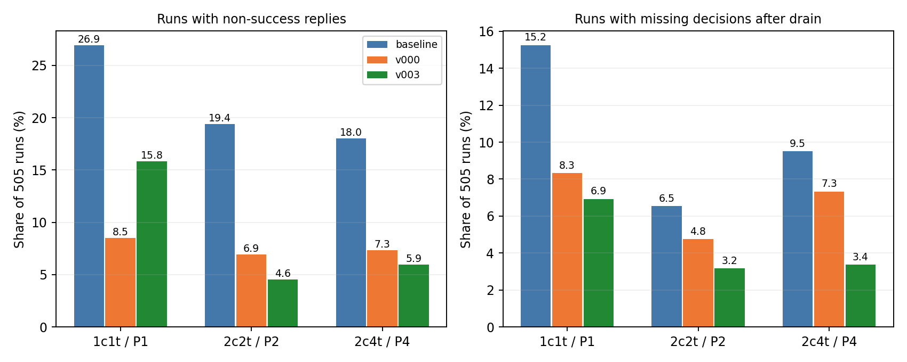
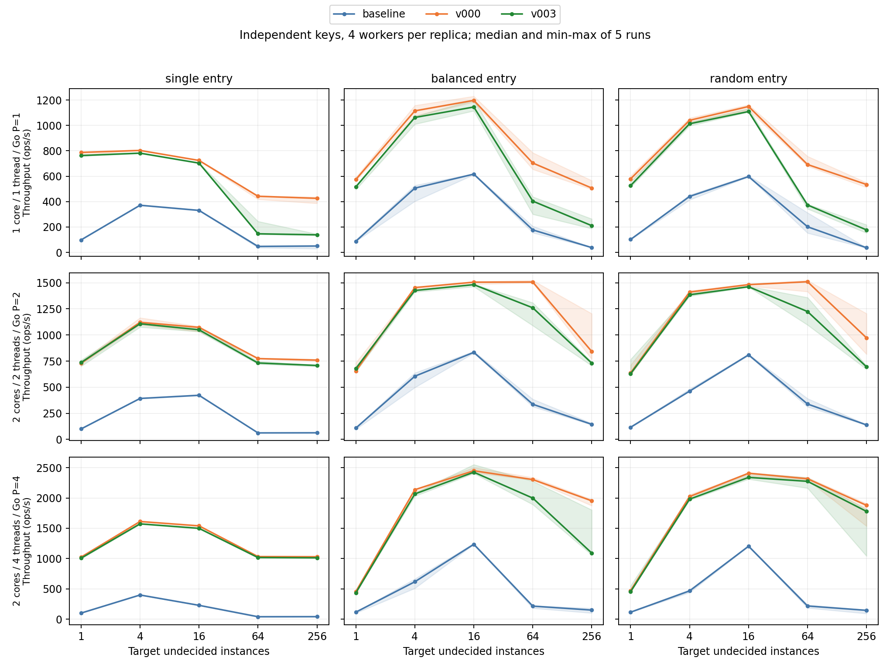

# 服务器闭环测试分析：2026-11-15

本次分析来自桌面的 `server-summary-1111.tar.gz`，对应 **11 月 11 日的 baseline、Forge v000（a49b2c8）和 v003（84a6445）**。6,140 个计划任务全部完成，启动记录为 11 月 13 日 17:59，最终日志为 11 月 15 日 17:10，约 47 小时 10 分；逐任务耗时合计 47.09 小时。

在本次闭环负载下，主要结果是：Forge 初始实现已经在独立键吞吐、冷历史获取上明显优于 baseline；后续修复大幅改善多协调者热点和部分历史负载，减少收尾未决定工作，但没有全面提高性能。v000 普通路径通常更快；v003 在单核高并发下还有明显回退。baseline 在资源较充足的多入口热点上仍有优势。

本报告保留旧闭环负载、短等待和成功子集延迟的测量结果，主要用于比较已交付实现并定位成本。新固定速率方法见 [evaluation.md](../../../evaluation.md)，本报告不包含其四机正式结果。

## 1. 条件与统计口径

单台 Xeon Gold 6148，20 个物理核、40 个硬件线程、约 62 GiB 内存，Go 1.25.8。共同测试每个副本独立进程、物理核互不共享，负载器另占两个物理核；三档为 1核1线程/Go P=1、2核2线程/Go P=2、2核4线程/Go P=4。默认七副本，n=7、f=4、s=1、e=1、K=64、W=200 ms、64 B 载荷；专项场景改变对应参数。

每个“场景 × CPU × 版本”独立运行五次；性能与空闲窗口均为 30 秒。N 是负载器目标未决定实例数的上限，等待接纳的请求也占用名额，实际共识并发由接纳与首次决定事件统计。worker 是各自实现配置，工作池含义不同，不能当作统一处理数量；二者都不等于 CPU 数。下文吞吐和已完成请求 P99 分别取五次指标的中位数，P99 不是合并所有请求重新计算的分位数；UNKNOWN/INCOMPLETE 与收尾缺决定数量按五次合计。阴影和范围表示最小值至最大值，不是置信区间。

计划、逐次 CSV 和配置 CSV 已交叉核对：无缺失或重复任务，各配置五次齐全，记录的物理核/硬件线程/Go P 与计划相符。4,545 次性能任务均标记观察完成；`measured` 只表示取得了测量结果，仍可能包含 UNKNOWN、INCOMPLETE 或未完成工作。

| 组         |                           场景数 | 运行次数 | 结果                              |
| ---------- | -------------------------------: | -------: | --------------------------------- |
| 原生测试   | 2，其中专用历史回归只适用于 v003 |       20 | 通过                              |
| 共同正确性 |                               24 |    1,080 | 1,065 passed，15 observed_failure |
| 性能       |                              101 |    4,545 | 全部 measured                     |
| 历史       |                               11 |      495 | 360 measured、105 passed、30 observed_failure（冷读等待超时） |
| **合计**   |                          **138** | **6,140** | |

这一旧方法的解释范围如下：

- 负载器收到首次决定事件后才补发新请求，因此不同实现与观测速度会产生不同的实际输入速率。同一个 N 是相同闭环控制参数，不是相同的每秒输入量或实际并发。
- 普通请求按各自调用设置约 15 秒等待，不是所有请求统一在测量开始后第 15 秒截止。成功延迟从客户端发起到取得回复，但只包含取得执行结果的请求；更慢请求没有完整延迟，不能把该子集 P99 当作整体尾延迟。
- 请求回复收集后只做有限事件导出，历史场景另有 30 秒排空观察。收尾缺决定反映该时刻的记录，不能证明永久不推进，也不能代替“全部请求均执行并返回”。
- CPU 与 Go P 提供明确资源条件；相同 worker 数不表示内部工作池数量和职责相同。跨负载累计的等待结束数量还受到实际请求量影响，不能直接当总体失败率。

这些限制不取消已经观测到的吞吐差异或具体代码问题，但需要在对应负载、等待期与资源条件内解释；固定输入速率下的完整延迟与整批吞吐须由新实验测量。

## 2. 回复与收尾

以下仅统计性能组，每版 1,515 次。本组 UNKNOWN、INCOMPLETE 表示调用等待结束时未取得执行结果，没有 REJECTED 或传输错误。这是响应与进度统计，不是协议错误计数。缺决定是观察结束时已接纳但尚未记录首次决定，与客户端回复状态处于不同阶段；已决定但尚未回复的请求也可能返回 UNKNOWN。

| 版本     | UNKNOWN/INCOMPLETE 的任务 / 1,515 | UNKNOWN（条） | INCOMPLETE（条） | 收尾缺决定任务 / 1,515 | 缺决定累计（实例） |
| -------- | ---------------------: | ------------: | ---------------: | ---------------------: | -----------------: |
| baseline |           325（21.5%） |        33,885 |            8,866 |                    158 |             12,020 |
| v000     |            115（7.6%） |        25,323 |              590 |                    103 |              5,119 |
| v003     |            133（8.8%） |        23,524 |            3,217 |                     68 |              3,403 |

v003 相比 v000，收尾缺决定任务减少约 34%，累计缺决定实例减少约 33.5%；但UNKNOWN/INCOMPLETE 的任务由 115 增至 133，UNKNOWN/INCOMPLETE 总数由 25,913 增至 26,741。

每格为 **出现 UNKNOWN/INCOMPLETE 的任务数 / 收尾缺决定的任务数**；每个 CPU 档位、每版均有 505 次性能任务。

| 每副本 CPU 配置   | baseline |    v000 |    v003 |
| ----------------- | -------: | ------: | ------: |
| 1核1线程 / Go P=1 | 136 / 77 | 43 / 42 | 80 / 35 |
| 2核2线程 / Go P=2 |  98 / 33 | 35 / 24 | 23 / 16 |
| 2核4线程 / Go P=4 |  91 / 48 | 37 / 37 | 30 / 17 |

单核时，v003 中出现 UNKNOWN/INCOMPLETE 的任务明显多于 v000；两核两线程和两核四线程时，两项任务计数都比 v000 少。

## 3. 原生与共同功能检查

| 检查             |     baseline |         v000 |         v003 |
| ---------------- | -----------: | -----------: | -----------: |
| 原生完整套件     |     5/5 通过 |     5/5 通过 |     5/5 通过 |
| 原生专用历史回归 |           — |           — |     5/5 通过 |
| 共同正确性       | 345/360 通过 | 360/360 通过 | 360/360 通过 |

baseline 的 15 次共同检查失败全部来自 overload：三档 CPU 下均为 5/5 失败。该场景在 Queue=1、K=1、worker=1 的压力结束后检查新请求能否继续完成。这表示进度检查在给定等待期内未完成，不是安全性违反计数；冷历史读取的完成时间单列在第 7 节。

baseline 过载代表任务的 96 次突发请求为 1 UNKNOWN、95 OVERLOADED；停止压力两秒后，再发的新请求等待 15 秒，仍返回 INCOMPLETE。七副本均没有决定或执行，副本 0 的唯一槽位仍被旧请求占用，新请求在排队，累计队列丢弃计数约 115 万。源码中广播按成员顺序往同一个容量为 1 的发送队列投递，满队列直接丢弃，符合小队列下重复工作挤占有效传播的现象。该现象不是合理拒绝过载请求本身，而是压力结束后在额外观察期内仍未恢复进度；具体消息的饥饿链还需事件记录定位。

该任务的 `drain.complete=true` 不能表示工作已经排空：检查脚本取“已观察到的最大决定数”作为执行目标，这次目标为零，自然通过；`checks` 也只检查了零条已决定历史。任务总体仍正确标为失败，依据是新请求未完成。这个细节说明局部通过标志必须结合检查范围解释。

## 4. 普通路径、并发与 CPU 扩展

全部 180 组独立键配置中，两版 Forge 的吞吐中位数都高于 baseline；这部分优势在 v000 阶段已经存在。以下固定均衡入口、N=16、worker=4，每格为 **吞吐（条/秒） / 已完成请求 P99（毫秒）**，这九组的五次运行都没有 UNKNOWN/INCOMPLETE。

| 每副本 CPU 配置   |       baseline |           v000 |           v003 |
| ----------------- | -------------: | -------------: | -------------: |
| 1核1线程 / Go P=1 |   616.7 / 66.6 | 1,197.6 / 59.8 | 1,145.1 / 75.5 |
| 2核2线程 / Go P=2 |   833.5 / 43.1 | 1,506.0 / 35.6 | 1,482.3 / 35.9 |
| 2核4线程 / Go P=4 | 1,235.0 / 28.9 | 2,448.8 / 40.9 | 2,425.0 / 25.5 |

这个负载中，v003 比 v000 慢约 4.4%、1.6%、1.0%。从两核两线程到两核四线程，三者吞吐分别提高约 48%、63%、64%；这里同时增加了硬件线程与 Go P，不能单独归因于 SMT，也不能据此证明加速全部来自共识核心并行。

较高目标 N 下，修复后版本的吞吐退化更明显；具体成本归因仍需剖析。均衡入口、N=256、worker=4，v000→v003 的吞吐分别为 **507→211、842→730、1,953→1,091 条/秒**，三档下降约 58%、13%、44%。每版各 900 次独立键测量中，v000 没有 UNKNOWN/INCOMPLETE，v003 有 30 次，全部集中在单核、均衡/随机入口、N=256；这些运行收尾时都已观察到首次决定，故不能把客户端 UNKNOWN/INCOMPLETE写成未提交。

补充的单核、均衡 N=256、worker=4 第一次运行揭示了退化形态：

| 指标                               |           v000 |             v003 |
| ---------------------------------- | -------------: | ---------------: |
| 吞吐（条/秒）                      |          505.5 |            188.0 |
| OK / UNKNOWN / INCOMPLETE（条）    | 15,421 / 0 / 0 | 5,854 / 157 / 67 |
| 已完成请求 P99（毫秒）                   |          2,899 |           12,434 |
| 七副本 CPU 合计（100%=一个逻辑核） |           643% |             515% |
| 本地 collection 窗口短缺累计（次） |            147 |            2,428 |

两版收尾均在七副本执行完全部已接纳实例。v003 的副本 0 接近一个核满载，其他副本约 67%～72%，负载器约 30%；因此不能只解释为全部 CPU 都用满。协议 HTTP 接收率除以成功吞吐约由 96 增至 183 次/条，提示单位成功产出的协议工作增多，但该比值包含后台工作、采样区间也略有差别，不等于精确重传数。窗口计数、负载不均与长尾支持继续检查调度和恢复放大；目前没有 profile 将回退归因到某一项修复。

worker 增加也不保证加速。两核两线程、均衡入口 N=16，worker 从 1 增至 8：baseline 为 265→932 条/秒，v000 为 1,477→1,505，v003 为 1,471→1,476。对 Forge，这个配置下单纯加 worker 收益很小。

实际并发仍需单列。下表是两核两线程、worker=4 的时间平均未决定实例数，单位为 **个实例**，取五次中位数：

| 入口与目标 N    | baseline |   v000 |   v003 |
| --------------- | -------: | -----: | -----: |
| 单入口，N=256   |    63.40 |  63.81 |  63.81 |
| 均衡入口，N=64  |    61.83 |  62.52 |  62.78 |
| 均衡入口，N=256 |   168.54 | 204.01 | 249.38 |
| 随机入口，N=256 |   165.42 | 115.52 | 243.89 |

单入口受 K=64 的本地槽位限制，N=256 不会形成 256 个实际共识实例。均衡/随机入口也没有自动达到相同实际并发，因此这些数字比较的是同闭环控制参数下的表现，不能解释为相同输入速率下的响应能力，也不能把吞吐差直接换算成同等实际并发下的每命令计算成本。

## 5. 热点：修复明显有效，baseline 也有优势

同键 Put，N=64、worker=4。每格为 **吞吐中位数（条/秒） / UNKNOWN/INCOMPLETE（条，五次合计）**。

| CPU 与入口     |  baseline |         v000 |         v003 |
| -------------- | --------: | -----------: | -----------: |
| 1核1线程，均衡 | 2.2 / 667 | 0.03 / 2,012 | 73.9 / 2,056 |
| 1核1线程，随机 | 2.2 / 683 |  2.1 / 2,051 | 32.8 / 2,159 |
| 2核2线程，均衡 | 311.4 / 0 | 17.8 / 1,247 |  152.0 / 402 |
| 2核2线程，随机 | 316.5 / 0 |   34.8 / 262 |  161.2 / 393 |
| 2核4线程，均衡 | 296.0 / 0 | 0.10 / 2,264 |  103.8 / 803 |
| 2核4线程，随机 | 334.8 / 0 | 0.03 / 2,358 | 78.3 / 1,156 |

v000 多入口热点在部分配置下几乎不产出成功回复，v003 明显恢复了服务能力。整个热点组收尾缺决定从 v000 的 2,285 个降到 v003 的 58 个，约减少 97.5%；但 v003 仍累计出现 15,869 条 UNKNOWN/INCOMPLETE，不能写成热点问题已经消失。两核配置下 baseline 的多入口热点吞吐仍高于 v003。

单入口热点则不同：两核两线程、worker=4，baseline/v000/v003 为 112/772/724 条/秒，均无UNKNOWN/INCOMPLETE。问题不只是“同一个键”，多协调者同时处理冲突会显著改变表现。已完成请求 P99 在这里尤其容易误导：某些 v000 运行只有极少请求成功，该子集的低 P99 并不代表整体响应快。

## 6. 载荷、延迟与恢复条件

以下均衡入口、N=64、worker=4、两核两线程。每格为 **吞吐（条/秒） / 已完成请求 P99（毫秒） / UNKNOWN/INCOMPLETE（条，五次合计）**。

| 场景              |              baseline |                 v000 |                 v003 |
| ----------------- | --------------------: | -------------------: | -------------------: |
| 1 KiB             |   273.5 / 3,263.8 / 0 |  1,236.4 / 352.0 / 0 |    864.6 / 598.6 / 0 |
| 16 KiB            |    78.9 / 7,100.4 / 0 |  132.1 / 6,778.7 / 0 |  132.9 / 6,809.1 / 0 |
| 64 KiB            | 15.8 / 12,289.0 / 170 | 19.8 / 4,978.3 / 319 | 17.7 / 5,450.7 / 310 |
| 额外接收延迟 1 ms |     204.6 / 415.8 / 0 | 119.3 / 10,687.1 / 0 |   200.0 / 895.9 / 75 |
| 额外接收延迟 5 ms | 15.4 / 13,200.8 / 247 | 7.9 / 11,542.4 / 371 | 7.5 / 12,442.6 / 362 |
| W=50 ms           |   296.0 / 1,926.6 / 0 |    795.0 / 314.3 / 0 |    590.0 / 324.9 / 0 |
| W=1,000 ms        |   418.2 / 1,585.4 / 0 |  1,531.2 / 103.3 / 0 |  1,529.0 / 104.5 / 0 |
| 崩溃两个副本      |     271.2 / 270.4 / 0 |    231.1 / 313.0 / 0 |    268.8 / 274.4 / 0 |
| 崩溃四个副本      |     133.9 / 523.8 / 0 |    119.5 / 620.7 / 0 |    125.9 / 540.0 / 0 |

64 KiB 下，两版 Forge 不仅吞吐低，收尾还分别缺 319、310 个首次决定；baseline 有 170 条 UNKNOWN/INCOMPLETE，但该组收尾缺决定为零。1 ms 延迟下，v003 的吞吐中位数高于 v000，却额外出现 UNKNOWN/INCOMPLETE 和缺决定，因此不能只看吞吐判定改善。三者在各自的 90 次崩溃后性能测量中均无UNKNOWN/INCOMPLETE或收尾缺决定。

64 KiB 的第一次运行中，v000/v003 分别为 609/539 条 OK，均有 64 条 UNKNOWN，七副本收尾都保留同样数量的未决定实例；这 64 个实例均由副本 0 接纳，占满其 K=64 槽位。两版没有缺失数据或暂存记录，瓶颈已落在决定推进。七副本合计 CPU 约 1,173%/1,197%，分配约 4,351/4,491 MiB/s，协议接收量约 578/597 MiB/s，窗口短缺计数为 765/756。这是两版共有的大载荷进度与成本问题，不能归为 v003 独有；也不能由配置了 W=200 ms 就认定实际满足窗口前提。

这个优势有范围：64 KiB、worker=4 的三档 CPU 下，baseline 五次合计均没有收尾缺决定，但仍有 UNKNOWN/INCOMPLETE。扩大到全部载荷与 worker 配置，baseline 的 90 次任务中也有 26 次收尾缺决定，累计 1,080 个实例；v000/v003 分别为 38/41 次、2,050/2,295 个实例。因此大载荷问题并非 Forge 独有，具体配置上的进度差异仍然成立。

小窗口收益并不稳定：此前三次、两核的测量曾显示 W=50 ms 对 v003 有优势，本次五次测量的中位数却是 v000 795、v003 590 条/秒。单核 v003 同一配置五次为 180.5、494.7、53.2、66.3、484.4 条/秒，波动远大于普通低并发负载。应保留逐次值与范围，不能沿用上次单个场景的结论。配置 W 不等于已经证明运行全过程满足协议的时间前提。

## 7. 历史：新请求速度与旧工作排空是两件事

两核两线程、全部历史已执行后停止新请求，七副本合计的临时分配率（MiB/秒）为：

| 已执行历史（条） | baseline | v000 |  v003 |
| ---------------- | -------: | ---: | ----: |
| 0                |     5.40 | 4.24 |  8.11 |
| 1,000            |    16.33 | 6.81 | 10.74 |
| 10,000           |   114.68 | 6.77 | 10.67 |

baseline 的空闲分配量随历史明显增长，Forge 在这几个规模下较稳定；v003 的固定开销高于 v000。H=10,000 时，七副本 CPU 合计约为 71%、36%、51%（100% 对应一个逻辑 CPU 的时间），不是物理核数。整个矩阵中记录的各副本峰值 RSS 之和最大约 5.54 GiB，未呈现逼近 62 GiB 容量的迹象；但最高临时分配率超过 5 GiB/秒，分配和 GC 成本不能忽略，也不能把分配率当作内存泄漏。

冷历史场景先阻断一个存活副本的数据，解除限制后从它读取旧键。全部三档 CPU 下，baseline 共 15/45 次在 15 秒等待内取得读结果，两版 Forge 均为 45/45；baseline 未完成项全部来自 H=1,000/5,000。以下两核两线程，每格为 **15 秒内完成次数/5；读取调用耗时中位数**：

| 历史（条） | baseline                | v000         | v003         |
| ---------- | ----------------------- | ------------ | ------------ |
| 100        | 5/5；4.57 秒            | 5/5；1.23 秒 | 5/5；1.23 秒 |
| 1,000      | 0/5；15.01 秒（等待结束） | 5/5；1.16 秒 | 5/5；1.09 秒 |
| 5,000      | 0/5；15.01 秒（等待结束） | 5/5；4.02 秒 | 5/5；3.88 秒 |

其他两档 CPU 结论相同：baseline 的 1,000/5,000 条冷历史读取均未在 15 秒内完成，额外 30 秒排空检查也未完成；两版 Forge 均取得读结果，且在随后观察期内全部副本达到本场景的执行目标。补充的两核首次运行确认 baseline 返回 UNKNOWN；解除限制约 45 秒后，其他六副本已经执行 1,001/5,001 条，包括新读命令，冷副本却仍没有记录决定或执行。因此不是整个集群没有决定，而是落后副本未完成依赖补齐与本地处理。其实现通过 Fetch 获取直接依赖，再递归检查完整性并等待周期重试；长链逐步获取与反复检查是具体调查方向，当前包不足以确定各项耗时。

待处理历史场景限制部分旧决定传播，继续向该副本发送独立新请求；旧脚手架仍允许 Done 恢复回复，因此限制不能等同于阻止所有决定到达，需结合实际形成的积压解释。H=10,000、W=10 秒、N=16、worker=4，新请求吞吐（条/秒）为：

| 每副本 CPU 配置   | baseline |    v000 |    v003 |
| ----------------- | -------: | ------: | ------: |
| 1核1线程 / Go P=1 |      8.1 |   423.7 |   623.0 |
| 2核2线程 / Go P=2 |    103.5 |   774.7 |   991.1 |
| 2核4线程 / Go P=4 |     14.0 | 1,216.7 | 1,340.9 |

v003 相比 v000 分别提高约 47%、28%、10%，两版新请求都没有 UNKNOWN/INCOMPLETE。但 H=1,000/10,000 的每版 30 次待处理历史运行中，**v000 和 v003 解除限制后再等 30 秒，均未达到所有存活副本排空的条件**；baseline 为 5/30 未排空，集中在单核 H=10,000。

补充的两核 H=10,000 第一次运行中，解除限制后，v000/v003 分别补齐并执行旧实例 355/387 条，还剩 9,645/9,613 条；并非完全不推进。源码后台每 W/4 最多访问 32 个实例，W=10 秒时名义批次速率为 12.8 条/秒，与本次约 11.8/12.9 条/秒的补齐量相符。新请求快与旧工作追赶快是两个不同指标；修复改善了前者，没有消除这里的批次限制。

## 8. 这次比较可以明确说明什么

- **生成阶段的收益已经可见。** v000 的普通吞吐、冷历史处理和过载后服务表现优于本次 baseline；这些不是修复阶段才得到的。
- **修复有针对性收益，也有代价。** v003 大幅改善多协调者热点的决定进度，提高带待处理历史时的新请求吞吐；普通高并发吞吐、单核超时表现和空闲成本则有回退。不能把修复收益包装成全场景性能提高。
- **正确性与性能要分别举证。** 本次共同检查不能进一步区分 v000 与 v003 的安全性水平。协议符合与安全性提升应对应已有审计反例和有效修复；本次数据补充的是这些具体交付在部署负载下的表现。
- **五次重复揭示了边界。** 普通负载与部分修复收益能够复现，热点和短窗口仍有大幅波动。应报告每次结果、状态及范围；同一种子重复五次主要检验运行波动，不等于五种不同负载。

## 9. 证据与仍需定位的内容

补充材料已解压到 [details](details)，计算摘录见 [analysis.json](details/analysis.json)，测试有效性复核的命令与原始记录见[诊断说明](details/README.md)。

当前证据能区分观察期内的过载后停滞、冷副本补齐缓慢、单核长尾、大载荷未决定与旧历史缓慢追赶。仍需定位的是过载时具体被挤占的消息、冷历史的主要耗时，以及哪些修复导致单核退化。新测试将改用固定速率、延长原调用等待、保留完整批次指标并观察历史追赶曲线；成本归因仍需针对性的事件或剖析，不能仅靠延长时限得到。

数据与复算：[完整配置汇总](REPORT.md)、[6,140 次逐次数据](summary.csv)、[匹配配置的中位数与范围](matched-metrics.csv)、[复算脚本](analyze.py)。图与表由这次 CSV 计算。
