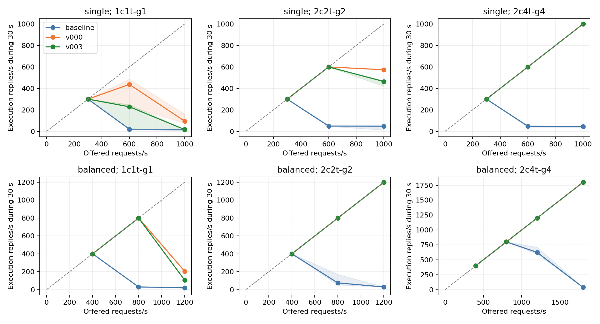

# Server A：普通请求的吞吐、延迟与 CPU 扩展，阶段结果

对象是 **11 月 11 日的 baseline、Forge v000（a49b2c8）和 v003（84a6445）**。

## 1. 测试项目与数据范围

服务器为 Xeon Gold 6148，20 个物理核、40 个硬件线程，约 62 GiB 内存，Go 1.25.8。七个独立副本分别绑核，负载器另占两个物理核。三档为 1核1线程/Go P=1、2核2线程/Go P=2、2核4线程/Go P=4；已核对实际绑核与 Go P。默认 n=7、f=4、s=1、e=1、K=64、W=200 ms、64 B 值。

每条请求写入一个新的键，因此请求之间没有键冲突。单点入口表示请求都先提交给同一个副本；均衡入口表示轮流提交给七个副本；随机入口按预设随机序列选择副本。这是请求入口分布，不是固定的共识并发数。

每项重新启动集群，先执行 70 条预热请求。正式发送不等待前一条回复，每条请求使用新的请求号，不自动重试；发送结束后最多再等 300 秒。发送期吞吐只计该期间收到的执行回复；整批吞吐则把最后一条执行回复前的等待也算进去。延迟从客户端实际发出请求到收到执行回复，包含排队时间。本组每个正式任务持续发送 30 秒，例如 800 条/秒对应 24,000 条请求。

| 测试项目 | 已有结果 / 原计划任务 | 当前范围                                                    |
| -------- | --------------------: | ----------------------------------------------------------- |
| 校准     |                   3/3 | 全部完成                                                    |
| 单点入口 |               225/225 | 已测完，正文保留 300、600、1,000 条/秒                      |
| 均衡入口 |               270/270 | 已测完，正文保留 400、800、1,200 及两核四线程的 1,800 条/秒 |
| 随机入口 |               140/270 | 100、400、800 条/秒已各完成五次；1,200 条/秒刚开始          |

共 **638/768** 个任务有结果，400 次整批完成、188 次有已发出请求未取得执行回复、50 次含发送器漏发；无运行器错误或事件观察缺口。原有 451 项结果没有变化，新增 187 项；覆盖计数不随正文删减改变。

吞吐、延迟取各次运行的中位数。**执行回复率＝观察结束前收到执行回复的请求数 / 实际发出的请求数**，按该配置已有轮次合计；被拒绝和观察结束未回复都不计为完成，漏发另行说明。延迟只在该格所有已有轮次均整批完成时列出，其他情况记为“—”。每个组合计划五次；正文保留低负载、承载边界和明显差异，完整档位及逐次数据见文末 CSV。

## 2. 所有请求都交给同一个副本

每格为 **发送期吞吐（条/秒）；执行回复率**。吞吐只计发送期间，执行回复率包含之后最多 300 秒的等待。

| 场景 / 每副本 CPU     |     baseline |          v000 |          v003 |
| --------------------- | -----------: | ------------: | ------------: |
| 300 条/秒，1核1线程   |  299.9；100% |   300.0；100% |   300.0；100% |
| 300 条/秒，2核2线程   |  299.9；100% |   300.0；100% |   300.0；100% |
| 300 条/秒，2核4线程   |  299.9；100% |   300.0；100% |   300.0；100% |
| 600 条/秒，1核1线程   | 20.2；25.96% | 437.1；90.06% | 228.8；36.71% |
| 600 条/秒，2核2线程   | 48.9；30.99% |   600.0；100% |   600.0；100% |
| 600 条/秒，2核4线程   | 47.4；30.68% |   600.0；100% |   600.0；100% |
| 1,000 条/秒，1核1线程 | 18.9；13.01% |  95.1；24.18% |   17.0；4.24% |
| 1,000 条/秒，2核2线程 | 47.7；17.82% | 573.8；70.98% | 464.0；59.05% |
| 1,000 条/秒，2核4线程 | 44.4；17.95% | 1,000.0；100% | 1,000.0；100% |

300 条/秒时三版都能跟上输入。从 600 条/秒开始，baseline 吞吐明显下降并出现大量拒绝；两版 Forge 在两核两线程下仍能完整处理 600 条/秒，在两核四线程下能完整处理 1,000 条/秒。

修复代价也很明显：单核、1,000 条/秒时，v000 约 95 条/秒，v003 约 17 条/秒；两核两线程下分别约 574 与 464 条/秒。这些差异已足以说明修复对压力场景的影响，不再继续铺陈更高档位。

## 3. 把请求分给多个协调者

### 3.1 均衡入口

每格为 **发送期吞吐（条/秒）；执行回复率**。吞吐只计发送期间，执行回复率包含之后最多 300 秒的等待。

| 场景 / 每副本 CPU     |      baseline |          v000 |          v003 |
| --------------------- | ------------: | ------------: | ------------: |
| 400 条/秒，1核1线程   |   399.8；100% |   400.0；100% |   400.0；100% |
| 400 条/秒，2核2线程   |   399.9；100% |   400.0；100% |   400.0；100% |
| 400 条/秒，2核4线程   |   399.9；100% |   400.0；100% |   400.0；100% |
| 800 条/秒，1核1线程   |   29.9；4.87% |   799.9；100% |   799.6；100% |
| 800 条/秒，2核2线程   |  74.7；23.16% |   800.0；100% |   800.0；100% |
| 800 条/秒，2核4线程   |   799.8；100% |   800.0；100% |   800.0；100% |
| 1,200 条/秒，1核1线程 |   19.7；1.99% | 205.4；95.19% | 107.5；45.83% |
| 1,200 条/秒，2核2线程 |  29.2；10.98% | 1,199.9；100% | 1,199.9；100% |
| 1,200 条/秒，2核4线程 | 624.8；70.24% | 1,200.0；100% | 1,199.9；100% |
| 1,800 条/秒，2核4线程 |  37.0；12.53% | 1,799.9；100% | 1,799.9；100% |

均衡入口扩大了 Forge 能跟上的输入范围。两核四线程下，1,800 条/秒仍接近输入速率，因此保留这一代表点；同档 baseline 约 37 条/秒。单核和两核两线程更高档位的重复过载结果不再展开。

两核四线程、1,800 条/秒时，v000 五次共漏发 2 条，v003 共漏发 3 条，实际发出的请求全部收到执行回复。因此上表执行回复率均为 100%，但不等于负载器完成了全部计划发送。



上排单点入口，下排均衡入口；横轴为输入速率，纵轴为发送期吞吐，单位均为条/秒。实线为五次中位数，阴影为最小到最大范围，灰色虚线表示跟上输入。各图仅展示正文保留的档位。

### 3.2 随机入口

随机入口的 100、400、800 条/秒已各完成五次，前两档三版均完整完成。下面保留 800 条/秒，每格仍为 **发送期吞吐（条/秒）；执行回复率**。

| 场景 / 每副本 CPU   |     baseline |        v000 |        v003 |
| ------------------- | -----------: | ----------: | ----------: |
| 800 条/秒，1核1线程 |  25.1；4.17% | 799.7；100% | 799.5；100% |
| 800 条/秒，2核2线程 | 46.6；17.41% | 800.0；100% | 800.0；100% |
| 800 条/秒，2核4线程 |  799.9；100% | 800.0；100% | 800.0；100% |

结果与均衡入口相近：两版 Forge 在三档 CPU 下都完成了全部请求；baseline 只有两核四线程完整完成。随机 1,200 条/秒目前只有首轮的五个任务结果，暂不据此比较更高负载。

## 4. 能够完整处理时，客户端要等多久？

每格为 **整批平均延迟 / P99（毫秒）**。这些配置用于比较正常处理速度，不把过载轮次的成功请求单独拿出来当作完整延迟。

| 场景 / 每副本 CPU        |      baseline |         v000 |         v003 |
| ------------------------ | ------------: | -----------: | -----------: |
| 单点 300 条/秒，1核1线程 | 10.58 / 25.35 |  1.54 / 6.94 |  1.61 / 7.51 |
| 单点 300 条/秒，2核2线程 |  9.34 / 18.29 |  1.67 / 4.90 |  1.71 / 4.97 |
| 单点 300 条/秒，2核4线程 |  8.13 / 15.53 |  1.53 / 3.12 |  1.57 / 3.21 |
| 均衡 800 条/秒，1核1线程 |            — | 4.99 / 40.95 | 7.21 / 59.14 |
| 均衡 800 条/秒，2核2线程 |            — |  1.62 / 6.66 |  1.61 / 5.93 |
| 均衡 800 条/秒，2核4线程 |  7.35 / 14.71 |  1.24 / 3.20 |  1.32 / 3.29 |
| 随机 800 条/秒，1核1线程 |            — | 5.91 / 44.92 | 7.74 / 61.93 |
| 随机 800 条/秒，2核2线程 |            — |  1.70 / 6.89 |  1.78 / 7.04 |
| 随机 800 条/秒，2核4线程 |  7.51 / 14.28 |  1.23 / 2.92 |  1.29 / 3.23 |

单点 300 条/秒时，Forge 平均约 1.5～1.7 ms，baseline 约 8.1～10.6 ms。单核均衡 800 条/秒时，v003 的平均延迟约 7.21 ms、P99 约 59.14 ms，高于 v000 的 4.99 ms、40.95 ms；两核配置下差距小得多。随机 800 条/秒也出现相同趋势：单核 v003 平均 7.74 ms、v000 为 5.91 ms；两核配置差异较小。修复后的版本没有在普通路径上全面超过初始版本。

## 5. 当前结论与后续补齐

- **生成阶段的收益明显：**v000 在正常延迟、多入口吞吐和过载处理上已经明显优于 baseline。
- **修复有性能代价：**v003 正常轻负载通常略慢，在单核和部分高负载条件下退化更大。
- **CPU 和入口分布都重要：**相同实现单点过载，不等于均衡入口也达到上限；两核四线程显著扩大了本次 Forge 能跟上的输入范围。

剩余 130 项均属于随机入口的 1,200、1,800、2,600 条/秒。单点和均衡入口已全部测完；随机入口的高负载结论等待剩余结果。

## 6. 数据与复算

[回传数据包](server-ABC-evaluation/server-A-results.tar.gz)、[逐任务指标](server-ABC-evaluation/A-jobs.csv)、[配置中位数及最小／最大范围](server-ABC-evaluation/A-groups.csv)、[覆盖与统计摘要](server-ABC-evaluation/A-analysis.json)、[复算脚本](server-ABC-evaluation/analyze.py)。直接读取当前 638 个已结束任务的 result.json，未结束任务不计为失败。图形需要 matplotlib，其余统计使用 Python 标准库。

```bash
python3 docs/server-ABC-evaluation/analyze.py
```
