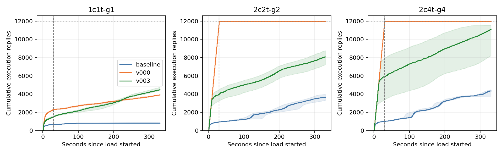

# Server C：附加消息延迟与副本崩溃后的服务能力

对象是 **11 月 11 日的 baseline、Forge v000（a49b2c8）和 v003（84a6445）**。

## 1. 测试项目与数据范围

服务器为 Xeon Gold 6148，20 个物理核、40 个硬件线程，约 62 GiB 内存，Go 1.25.8。七个独立副本分别绑核，负载器另占两个物理核。三档为 1核1线程/Go P=1、2核2线程/Go P=2、2核4线程/Go P=4；已核对实际绑核与 Go P。默认 n=7、f=4、s=1、e=1、K=64、W=200 ms、64 B 值。

每项重新启动集群，先执行 70 条预热请求。正式发送不等待前一条回复，每条请求使用新的请求号，不自动重试；发送结束后最多再等 300 秒。例如，30 秒负载的统一截止时间为开始后第 330 秒，每条请求实际可等待约 300～330 秒。发送期吞吐只计该期间收到的执行回复；整批吞吐则把最后一条执行回复前的等待也算进去。延迟从客户端实际发出请求到收到执行回复，包含排队时间。请求写入互不相同的新键，均衡提交给可用入口。正式发送通常为 30 秒；2 条/秒发送 150 秒，5 条/秒发送 60 秒，保证每项至少 300 条请求。

| 测试项目                   | 发送速率（条/秒）               | 已有结果 / 计划任务 | 当前范围 |
| -------------------------- | ------------------------------- | ------------------: | -------- |
| 校准                       | 100，持续 10 秒                 |                 3/3 | 全部完成 |
| 协议消息附加 1 ms 接收延迟 | 25、100、200、400               |             180/180 | 全部测完 |
| 协议消息附加 5 ms 接收延迟 | 2、5、10、20、40                |             225/225 | 全部测完 |
| 停止一个副本后发送         | 100、400、800、1,400            |             180/180 | 全部测完 |
| 停止两个副本后发送         | 50、150、250、400               |             180/180 | 全部测完 |
| 停止四个副本后发送         | 25、75、125、200                |             180/180 | 全部测完 |
| 负载进行中停止两个副本     | 100，持续 60 秒，在第 30 秒停止 |               45/45 | 全部测完 |

共 **993/993** 个任务全部结束，任务耗时合计约 18.13 小时：898 次整批完成、88 次有已发出请求未取得执行回复、7 次含发送器漏发；无运行器错误或事件观察缺口。

吞吐、延迟取各次运行的中位数。**执行回复率＝观察结束前收到执行回复的请求数 / 实际发出的请求数**，按该配置已有轮次合计；被拒绝和观察结束未回复都不计为完成，漏发另行说明。延迟使用实际发出的请求均取得执行结果的完整运行；不足五次时标明样本数，其余运行的未完成或错误结果仍保留，没有完整运行时记为“—”。如果只有漏发、其余请求均已完成，列出全部已发请求的延迟并注明漏发。整批完成次数仍按全部计划请求是否完成统计。

## 2. 每条协议消息额外等一下，会怎样？

测试在各副本的协议 HTTP 接收入口加入等待，请求和回复经过该入口都会受影响；客户端请求不直接加这个延迟。附加 1 ms 或 5 ms 是每次消息接收的额外等待，不是整条共识过程只多这么久。发送与后续观察期间均保持该设置，因此测的是带延迟条件下的持续服务，而不是解除延迟后的恢复。

### 2.1 附加 1 ms：正常负载与承载边界

下面与 5 ms 组使用同一指标格式：**吞吐为发送期执行回复数/秒，平均延迟和 P99 单位为毫秒，执行回复率包含后续等待。** 各配置五次；100 条/秒已列出全部三档 CPU，三版各次均全部完成。“—”表示不能从全部轮次得到完整延迟。

| 场景 / 每副本 CPU   |     版本 | 吞吐（条/秒） | 平均延迟（ms） | P99（ms） | 执行回复率 |
| ------------------- | -------: | ------------: | -------------: | --------: | ---------: |
| 100 条/秒，1核1线程 | baseline | 100.0 | 15.30 | 24.71 | 100% |
| 100 条/秒，1核1线程 | v000 | 100.0 | 5.52 | 10.83 | 100% |
| 100 条/秒，1核1线程 | v003 | 100.0 | 5.86 | 14.65 | 100% |
| 100 条/秒，2核2线程 | baseline | 100.0 | 12.74 | 19.85 | 100% |
| 100 条/秒，2核2线程 | v000 | 100.0 | 4.67 | 7.15 | 100% |
| 100 条/秒，2核2线程 | v003 | 100.0 | 4.93 | 9.72 | 100% |
| 100 条/秒，2核4线程 | baseline | 100.0 | 14.50 | 20.26 | 100% |
| 100 条/秒，2核4线程 | v000 | 100.0 | 4.72 | 6.82 | 100% |
| 100 条/秒，2核4线程 | v003 | 100.0 | 4.97 | 9.34 | 100% |
| 200 条/秒，1核1线程 | baseline |          97.1 |             — |        — |     62.77% |
| 200 条/秒，1核1线程 |     v000 |         200.0 |           7.47 |     13.89 |       100% |
| 200 条/秒，1核1线程 |     v003 |         200.0 |           7.84 |     16.22 |       100% |
| 400 条/秒，1核1线程 | baseline |          22.6 |             — |        — |      7.11% |
| 400 条/秒，1核1线程 |     v000 |          77.0 |             — |        — |     32.56% |
| 400 条/秒，1核1线程 |     v003 |          50.6 |             — |        — |     38.02% |
| 400 条/秒，2核2线程 | baseline |          31.9 |             — |        — |     30.76% |
| 400 条/秒，2核2线程 |     v000 |         399.7 |          21.15 |     48.22 |       100% |
| 400 条/秒，2核2线程 |     v003 |         133.6 |             — |        — |     67.16% |
| 400 条/秒，2核4线程 | baseline |          34.3 |             — |        — |     35.22% |
| 400 条/秒，2核4线程 |     v000 |         399.3 |          35.19 |     73.04 |       100% |
| 400 条/秒，2核4线程 |     v003 |         198.0 |             — |        — |     87.35% |

低负载下 Forge 明显更快。提高到 400 条/秒，两核配置的 v000 五次都完成，平均延迟约 21～35 ms；v003 两档均未整批完成，吞吐约 134、198 条/秒，baseline 约 32、34 条/秒。这个配置下 v003 相比 v000 已不只是小幅延迟增加，具体原因仍需定位到改动与运行路径。



每次发送 12,000 条，竖虚线为 30 秒停止发送，横虚线为全部请求完成；曲线为五次中位数，阴影为最小到最大范围。两核条件下 v000 基本随发送完成，baseline 和 v003 在额外 300 秒内仍有请求没有回复。单核条件下三版都未整批完成，v003 最终回复数量略多于 v000。

### 2.2 附加 5 ms：低负载的响应成本

已测的 2～40 条/秒均五次全部完成；下面列出 10、40 条/秒的全部三档 CPU，其余接近的低速率不再逐项列出。指标与上一表相同。

| 场景 / 每副本 CPU  |     版本 | 吞吐（条/秒） | 平均延迟（ms） | P99（ms） | 执行回复率 |
| ------------------ | -------: | ------------: | -------------: | --------: | ---------: |
| 10 条/秒，1核1线程 | baseline | 10.0 | 25.62 | 39.03 | 100% |
| 10 条/秒，1核1线程 | v000 | 10.0 | 14.61 | 21.88 | 100% |
| 10 条/秒，1核1线程 | v003 | 10.0 | 16.48 | 37.30 | 100% |
| 10 条/秒，2核2线程 | baseline | 10.0 | 24.77 | 39.63 | 100% |
| 10 条/秒，2核2线程 | v000 | 10.0 | 14.10 | 22.10 | 100% |
| 10 条/秒，2核2线程 | v003 | 10.0 | 15.13 | 31.44 | 100% |
| 10 条/秒，2核4线程 | baseline | 10.0 | 25.82 | 40.83 | 100% |
| 10 条/秒，2核4线程 | v000 | 10.0 | 13.98 | 20.30 | 100% |
| 10 条/秒，2核4线程 | v003 | 10.0 | 15.13 | 30.81 | 100% |
| 40 条/秒，1核1线程 | baseline |          40.0 |          30.79 |     47.17 |       100% |
| 40 条/秒，1核1线程 |     v000 |          40.0 |          18.15 |     26.82 |       100% |
| 40 条/秒，1核1线程 |     v003 |          40.0 |          20.69 |     43.06 |       100% |
| 40 条/秒，2核2线程 | baseline |          40.0 |          29.48 |     46.72 |       100% |
| 40 条/秒，2核2线程 |     v000 |          40.0 |          16.62 |     25.34 |       100% |
| 40 条/秒，2核2线程 |     v003 |          40.0 |          17.91 |     34.82 |       100% |
| 40 条/秒，2核4线程 | baseline |          40.0 |          29.41 |     46.02 |       100% |
| 40 条/秒，2核4线程 |     v000 |          40.0 |          16.54 |     25.24 |       100% |
| 40 条/秒，2核4线程 |     v003 |          40.0 |          17.88 |     35.10 |       100% |

吞吐都跟上输入，主要差别在延迟：v003 通常比 v000 慢约 1～3 ms，两版仍快于 baseline。1 ms 与 5 ms 组的输入速率不同，这些结果分别说明各自负载下的表现，不能据此直接比较两种附加延迟的容量。

## 3. 副本已经崩溃，剩下的副本还能处理多少请求？

本节分别用 800、400、200 条/秒比较停止一个、两个、四个副本时的三个版本。速率档位参考旧实验的吞吐量级及快慢路径差异；它们不是协议推导出的速率，也没有归一化为相同压力。因此可比较同一场景下的版本差异，不能直接用这些不同速率计算故障数增加造成的性能损失。

### 3.1 停止一个副本

先完成预热，再停止副本 0，把正式请求均衡发给剩余六个副本；各自仍使用原 CPU 配额。这测的是少一个副本后的新请求处理能力，不包含负载中途的故障注入。100、400 条/秒各配置都能完成，下表只保留 800 条/秒，指标与前两表相同；其他已测档位仍保留在原始数据和 CSV 中。

| 场景 / 每副本 CPU     |     版本 | 吞吐（条/秒） | 平均延迟（ms） | P99（ms） | 执行回复率 |
| --------------------- | -------: | ------------: | -------------: | --------: | ---------: |
| 800 条/秒，1核1线程   | baseline |         111.1 |             — |        — |     17.56% |
| 800 条/秒，1核1线程   |     v000 |         800.0 |           3.83 |     29.46 |       100% |
| 800 条/秒，1核1线程   |     v003 |         799.9 |           4.45 |     35.26 |       100% |
| 800 条/秒，2核2线程   | baseline |         101.1 |             — |        — |     31.26% |
| 800 条/秒，2核2线程   |     v000 |         800.0 |           1.58 |      6.06 |       100% |
| 800 条/秒，2核2线程   |     v003 |         800.0 |           1.58 |      5.87 |       100% |
| 800 条/秒，2核4线程   | baseline |         799.8 |           8.45 |     15.78 |       100% |
| 800 条/秒，2核4线程   |     v000 |         800.0 |           1.51 |      3.54 |       100% |
| 800 条/秒，2核4线程   |     v003 |         800.0 |           1.56 |      3.92 |       100% |

800 条/秒下，baseline 在单核和两核两线程已退化，Forge 仍全部完成。两核四线程下三版都完成，但 Forge 平均约 1.5～1.6 ms，baseline 约 8.4 ms。

### 3.2 停止两个或四个副本

预热后停止编号最小的两个或四个副本，分别向剩余五个或三个副本均衡发送。停止两个副本时，50～250 条/秒全部完成；停止四个时，25～125 条/秒全部完成。下面保留各组最高输入速率的 CPU 对照，每格五次。

| 场景 / 每副本 CPU           |     版本 | 吞吐（条/秒） | 平均延迟（ms） | P99（ms） | 执行回复率 |
| --------------------------- | -------: | ------------: | -------------: | --------: | ---------: |
| 停两个，400 条/秒，1核1线程 | baseline |          18.5 |             — |        — |     23.99% |
| 停两个，400 条/秒，1核1线程 |     v000 |         395.6 |         340.13 |    477.14 |       100% |
| 停两个，400 条/秒，1核1线程 |     v003 |         397.3 |         204.94 |    225.88 |       100% |
| 停两个，400 条/秒，2核2线程 | baseline |         396.9 |         234.84 |    277.09 |       100% |
| 停两个，400 条/秒，2核2线程 |     v000 |         395.7 |         306.50 |    417.16 |       100% |
| 停两个，400 条/秒，2核2线程 |     v003 |         397.3 |         203.44 |    215.79 |       100% |
| 停两个，400 条/秒，2核4线程 | baseline |         397.0 |         231.74 |    249.00 |       100% |
| 停两个，400 条/秒，2核4线程 |     v000 |         395.8 |         305.29 |    413.34 |       100% |
| 停两个，400 条/秒，2核4线程 |     v003 |         397.3 |         203.54 |    215.94 |       100% |
| 停四个，200 条/秒，1核1线程 | baseline |          12.9 |             — |        — |     34.88% |
| 停四个，200 条/秒，1核1线程 |     v000 |         195.7 |         655.39 |  1,344.37 |       100% |
| 停四个，200 条/秒，1核1线程 |     v003 |         197.2 |         430.76 |    472.08 |       100% |
| 停四个，200 条/秒，2核2线程 | baseline |         148.6 |      15,069.91 | 99,034.66 |       100% |
| 停四个，200 条/秒，2核2线程 |     v000 |         195.5 |         644.30 |  1,348.63 |       100% |
| 停四个，200 条/秒，2核2线程 |     v003 |         197.2 |         421.88 |    451.09 |       100% |
| 停四个，200 条/秒，2核4线程 | baseline |         196.9 |         462.44 |    496.16 |       100% |
| 停四个，200 条/秒，2核4线程 |     v000 |         195.6 |         648.69 |  1,357.14 |       100% |
| 停四个，200 条/秒，2核4线程 |     v003 |         197.2 |         420.30 |    446.69 |       100% |

这两组的延迟自然高于只停止一个副本：本配置快路径需要六票；只剩五个副本时无法走快路径，需要等待 W=200 ms 后进入 Accept。只剩三个副本时，Accept 也要经过小门槛收集，通常又多一个 W。因此约 200 ms 或 400 ms 的基础等待有协议原因，并不全是实现开销。

在上述较高负载下，v003 的新请求延迟和 P99 均低于 v000。停止两个、400 条/秒时，v003 平均约 203～205 ms，v000 约 305～340 ms；停止四个、200 条/秒时，分别约 420～431 ms 和 644～655 ms。低负载并非始终同样排序：停止四个、25 条/秒时，baseline 平均约 445～449 ms，比 v003 的 470～476 ms 更低。

baseline 单核在这两个最高速率下均未整批完成。停止四个、两核两线程时虽五次最终全完成，但波动很大：两次平均约 471 ms，另三次约 15.1～18.7 秒，并在停止发送后再等约 100～113 秒才收齐。表中的约 15 秒是五次中位数；仅看 100% 执行回复率会漏掉这个长尾。

## 4. 负载进行到一半时停止两个副本

连续以 100 条/秒发送 60 秒，在第 30 秒停止副本 5、6；客户端始终只访问副本 0～4，避免把“访问已停止的入口”混入测量。已核对 45 次的故障注入记录和入口配置。下表列出全部三档 CPU，每个配置五次；延迟覆盖整个 60 秒的请求，不是单独的故障后延迟。

| 场景 / 每副本 CPU        |     版本 | 吞吐（条/秒） | 平均延迟（ms） | P99（ms） | 执行回复率 |
| ------------------------ | -------: | ------------: | -------------: | --------: | ---------: |
| 第 30 秒停两个，1核1线程 | baseline | 99.6 | 121.96* | 246.78* | 99.997% |
| 第 30 秒停两个，1核1线程 | v000 | 99.6 | 117.60 | 259.44 | 100% |
| 第 30 秒停两个，1核1线程 | v003 | 99.7 | 103.98 | 209.33 | 100% |
| 第 30 秒停两个，2核2线程 | baseline | 99.6 | 120.21 | 241.23 | 100% |
| 第 30 秒停两个，2核2线程 | v000 | 99.6 | 115.37 | 254.17 | 100% |
| 第 30 秒停两个，2核2线程 | v003 | 99.7 | 102.95 | 206.05 | 100% |
| 第 30 秒停两个，2核4线程 | baseline | 99.6 | 120.11 | 241.25 | 100% |
| 第 30 秒停两个，2核4线程 | v000 | 99.7 | 115.12 | 253.52 | 100% |
| 第 30 秒停两个，2核4线程 | v003 | 99.7 | 102.87 | 204.89 | 100% |

三档 CPU 下，故障前发送期吞吐约 100 条/秒，故障后仍约 99.2～99.3 条/秒，余下回复主要在发送结束后收齐。两版 Forge 共 30 次全部完成。baseline 14 次完整，另一次单核运行收到 5,999/6,000 条执行回复及一条 TRANSPORT_ERROR；单核 baseline 的执行回复率为 29,999/30,000≈99.997%。标 * 的平均延迟 121.96 ms、P99 246.78 ms 是四次完整运行的中位数；第五次只有成功子集的延迟，未混入完整运行统计。该项约 61 秒结束，并非等待 300 秒后仍未完成。摘要没有保留这条传输错误的具体原因，不能据此认定协议出错。

## 5. 完整结果说明什么？

两版 Forge 在正常负载下的延迟较低，也能在副本崩溃后承受更高输入。新增的多故障结果显示，修复带来了明确收益：在上表的两个、四个副本崩溃场景中，v003 比 v000 的平均延迟低约 33%～40%、34%～35%，P99 也更低。

修复的代价仍然存在：两核、附加 1 ms、400 条/秒时，v000 及时完成，v003 长时间积压。当前数据确认了这些差异，但尚未把原因定位到具体修复。故障数增加后的基础等待，则应与协议的 W 门槛区分。

## 6. 数据与复算

[回传数据包](server-ABC-evaluation/server-C-results.tar.gz)、[逐任务指标](server-ABC-evaluation/C-jobs.csv)、[配置中位数及最小／最大范围](server-ABC-evaluation/C-groups.csv)、[覆盖与统计摘要](server-ABC-evaluation/C-analysis.json)、[复算脚本](server-ABC-evaluation/analyze.py)。直接读取全部 993 个任务的 result.json；延迟使用全部已发请求均完成的运行，实际样本数不足五次或存在漏发时单独标注；CSV 中的 issued_mean_ms、issued_p99_ms 可复算这一口径，原整批统计字段与状态仍保留。图形需要 matplotlib，其余统计使用 Python 标准库。

```bash
python3 docs/server-ABC-evaluation/analyze.py
```
